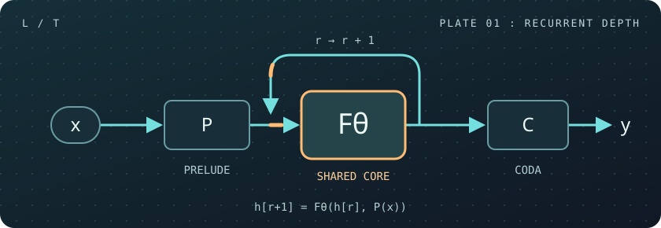

<b>English</b> · <a href="README.zh-CN.md">简体中文</a>

# Loop Transformer Atlas

**One set of weights. Several rounds of computation. What does the next pass buy?**

[**Open the interactive atlas →**](https://hyfine.github.io/loop-transformer-atlas/) · [Read the technical guide](docs/guide.en.md) · [Casebook](docs/routes.en.md) · [Evidence ledger](EVIDENCE.md)

A looped Transformer reuses a transformation **across depth**. The weights can stay the same while the activations change. This is not an agent repeatedly calling an LLM, and it is not a model writing a longer chain of thought. The [SenseNova-Loop-9B configuration](https://huggingface.co/sensenova/SenseNova-Loop-9B/blob/main/config.json) is a useful first example: **32 distinct layers; 56 layer executions**. The extra 24 executions come from revisiting the middle block, not from storing 24 more layers.

## Pick a way in

| If you want to… | Start here |
|---|---|
| Understand the idea in ten minutes | [Worked example, history and four controlled comparisons](docs/guide.en.md) |
| See the entire landscape | [Expand the family tree](https://hyfine.github.io/loop-transformer-atlas/#tree) · [Compare family/year swimlanes](https://hyfine.github.io/loop-transformer-atlas/#lanes) · [Replay the timeline](https://hyfine.github.io/loop-transformer-atlas/#time) |
| Follow data through a model | [A · Shared rules](https://hyfine.github.io/loop-transformer-atlas/#lab/A) · [B · Pretraining](https://hyfine.github.io/loop-transformer-atlas/#lab/B) · [C · Routing](https://hyfine.github.io/loop-transformer-atlas/#lab/C) · [D · Retrofit](https://hyfine.github.io/loop-transformer-atlas/#lab/D) · [E · KV & scheduling](https://hyfine.github.io/loop-transformer-atlas/#lab/E) · [F · Structured states](https://hyfine.github.io/loop-transformer-atlas/#lab/F) |
| Find a paper, implementation or checkpoint | [Search the library](https://hyfine.github.io/loop-transformer-atlas/#library) · [Primary-source casebook](docs/routes.en.md) · [Per-link visit records](data/visits.csv) |

## Frontier notebook · 26 November 2026

| Public date | What changed | Why it matters |
|---|---|---|
| Nov 25 | [Mixture-of-Loops Transformer](https://arxiv.org/abs/2611.34923v1) · [code](https://github.com/hustvl/MoLT) | A loop can pass KV memory from earlier positions instead of the same position’s residual. That changes what can run in parallel. |
| Nov 23 | [GLM-5.4](https://z.ai/blog/glm-5.4) · [LoopRes](https://arxiv.org/abs/2611.31094v2) | Two retrofit strategies: continue training a gated 28-layer block run twice, or learn to read selected residuals from earlier loops. The former is a publisher disclosure, the latter a preprint. |
| Nov 17–18 | [SenseNova-Loop-9B](https://github.com/OpenSenseNova/SenseNova-Loop) · [LoopCache](https://arxiv.org/abs/2611.24301v1) | The first exposes a two-stream, shared-middle decoder; the second schedules speculative verification to reduce long-context KV traffic. Not the same kind of memory saving. |
| Nov 2–3 | [Dory1.0-4B paper](https://arxiv.org/abs/2611.03998v1) / [weights](https://huggingface.co/nvidia/NVIDIA-Nemotron-Labs-Dory1.0-4B-BF16) · [ARLoop](https://arxiv.org/abs/2611.05234) | Dory retains the last visit’s historical KV at variable depth; ARLoop learns which past depth states to read during recurrent pretraining. |

**One comparison worth remembering:** [Huginn](https://arxiv.org/html/2502.05171v2) improves from 49.07 to 69.91 on ARC-Easy when *one checkpoint* moves from 4 to 32 visits. [LoopCoder-v2](https://arxiv.org/html/2606.18023v1) scores 43.0 → 64.4 → 27.6 on SWE-bench Verified for *separately trained* one-, two- and three-pass variants. The studies vary different things. Neither identifies a universal optimal depth.

## Scope and reuse

32 curated research/release records across six routes, plus a separate 333-record discovery index. The collections overlap; they are **not** 365 distinct loop architectures. Every curated record links to primary evidence and states a limitation. [Method, seed attribution and failed links](EVIDENCE.md) · [Contributing / running locally](CONTRIBUTING.md) · [Citation](CITATION.cff) · [Licenses](LICENSE).
