<b>English</b> · <a href="README.zh-CN.md">简体中文</a>

# Loop Transformer Atlas

**One set of weights. Several rounds of computation. What does the next pass buy?**

[**Browse the illustrated survey by chapter →**](https://hyfine.github.io/loop-transformer-atlas/#survey/digest) · [Download the workbook](survey/Loop_Transformer_Landscape.xlsx) · [Archive notes](survey/README.md)

**Recommended for desktop reading:** [Read the full illustrated survey in Chinese](survey/Loop_Transformer_Survey_zh_illustrated.md). All chapters, figures and tables are on one GitHub page.

**WeChat edition (中文):** [Read the full illustrated article in your browser](https://hyfine.github.io/loop-transformer-atlas/wechat/公众号正文.html) · [Open the original article in WeChat](https://mp.weixin.qq.com/s/Poxa25iG-8ZYJcdpjBVsDg) · [Publication files and artwork](wechat/README.md)

Read the panels as alternatives, not a pipeline: **B** changes *which layers run again*, **C** changes *which tokens run again*, and **E** changes *what the next pass can read*. [Explore the six methods →](https://hyfine.github.io/loop-transformer-atlas/#map)

A looped Transformer reuses a transformation **across depth**. The weights can stay the same while the activations change. This is not an agent repeatedly calling an LLM, and it is not a model writing a longer chain of thought. The [SenseNova-Loop-9B configuration](https://huggingface.co/sensenova/SenseNova-Loop-9B/blob/main/config.json) is a useful first example: **32 distinct layers; 56 layer executions**. The extra 24 executions come from revisiting the middle block, not from storing 24 more layers.

## The illustrated survey: from a repeated layer to an engineering decision

The November 26 survey indexes **376 papers in 13 families**, 17 model/release records and seven articles/reports. The web edition follows the source order; each chapter offers an English or Chinese reading guide, its figure plates, and the complete Chinese source section and tables. The workbook carries the underlying evidence and family tabs.

| In the survey’s order | Read it to answer… |
|---|---|
| [§0 Takeaways](https://hyfine.github.io/loop-transformer-atlas/#survey/digest) → [§1 Design space](https://hyfine.github.io/loop-transformer-atlas/#survey/design) | What repeats? Compare `ABAB` with `AABB`; distinguish storage from executions. |
| [§2 Six historical phases](https://hyfine.github.io/loop-transformer-atlas/#survey/history) → [§3 Family tree & lineage](https://hyfine.github.io/loop-transformer-atlas/#survey/lineage) → [§4 Swimlanes](https://hyfine.github.io/loop-transformer-atlas/#survey/lanes) | When did the question shift from representability to training, then to serving? Which edges mean more than chronology? |
| [§5 Four-layer taxonomy](https://hyfine.github.io/loop-transformer-atlas/#survey/taxonomy) → [§6 Thirteen investigations](https://hyfine.github.io/loop-transformer-atlas/#survey/families) | Model, training, inference, understanding/application: which experiment distinguishes one family from another? Each family has ten suggested papers. |
| [§7 Models & industrial practice](https://hyfine.github.io/loop-transformer-atlas/#survey/industry) → [§8 Trends](https://hyfine.github.io/loop-transformer-atlas/#survey/trends) → [§9 Open questions](https://hyfine.github.io/loop-transformer-atlas/#survey/questions) | Which claims are measured on a fixed checkpoint, at equal step time, or with matched FLOPs/KV? |
| [§10 Engineering decisions](https://hyfine.github.io/loop-transformer-atlas/#survey/decisions) → [§11 Sources](https://hyfine.github.io/loop-transformer-atlas/#survey/sources) → [Glossary](https://hyfine.github.io/loop-transformer-atlas/#survey/glossary) | Which weights may change, what budget is scarce, and what would disprove the claimed benefit? |

**Time-boxed reading:** 5 minutes → §0, §3, §8. 30 minutes → §1, §2, §4, §5, §7. Two hours → follow the full route and cross-check claims against the [130 family readings](survey/reading-list.csv) and [43 recent releases](survey/latest-papers.csv). These lists overlap. Full paper PDFs are linked to their publishers, not hosted here.

## Companion tools

| If you want to… | Start here |
|---|---|
| Understand the idea in ten minutes | [Worked example, history and four controlled comparisons](docs/guide.en.md) |
| See the entire landscape | [Research map](https://hyfine.github.io/loop-transformer-atlas/#map): switch between tree, swimlanes and timeline without losing the selected work. Open the classification key to see which comparison puts a work in each family. |
| See what changed in November | [Research directions](https://hyfine.github.io/loop-transformer-atlas/#directions): cross-loop memory, checkpoint conversion, KV capacity vs traffic, and allocating extra passes. Each includes a measurement and a proposed next test. |
| Read the original model diagrams in §7.3 | [GLM-5.4](https://hyfine.github.io/loop-transformer-atlas/#models/glm) · [SenseNova-Loop-9B](https://hyfine.github.io/loop-transformer-atlas/#models/sense) · [Dory1.0-4B](https://hyfine.github.io/loop-transformer-atlas/#models/dory) · [Ouro](https://hyfine.github.io/loop-transformer-atlas/#models/ouro) · [MoLT](https://hyfine.github.io/loop-transformer-atlas/#models/molt). Open each original at full size, read the survey’s Chinese notes and captions, and compare the experiments. SenseNova also includes its loop-scaling plot. |
| Follow a representative mechanism | [A · What can sharing do?](https://hyfine.github.io/loop-transformer-atlas/#lab/A) · [B · Build a looped model](https://hyfine.github.io/loop-transformer-atlas/#lab/B) · [C · Choose the depth](https://hyfine.github.io/loop-transformer-atlas/#lab/C) · [D · Convert a checkpoint](https://hyfine.github.io/loop-transformer-atlas/#lab/D) · [E · Run loops efficiently](https://hyfine.github.io/loop-transformer-atlas/#lab/E) · [F · Refine non-text states](https://hyfine.github.io/loop-transformer-atlas/#lab/F) |
| Find a paper, implementation or checkpoint | [Search the library](https://hyfine.github.io/loop-transformer-atlas/#library) · [Primary-source casebook](docs/routes.en.md) · [Per-link visit records](data/visits.csv) |

## Frontier notebook · 26 November 2026

| Public date | What changed | Why it matters |
|---|---|---|
| Nov 25 | [Mixture-of-Loops Transformer](https://arxiv.org/abs/2611.34923v1) · [code](https://github.com/hustvl/MoLT) | A loop can pass KV memory from earlier positions instead of the same position’s residual. That changes what can run in parallel. |
| Nov 23 | [GLM-5.4](https://z.ai/blog/glm-5.4) · [LoopRes](https://arxiv.org/abs/2611.31094v2) | Two retrofit strategies: continue training a gated 28-layer block run twice, or learn to read selected residuals from earlier loops. The former is a publisher disclosure, the latter a preprint. |
| Nov 17–18 | [SenseNova-Loop-9B](https://github.com/OpenSenseNova/SenseNova-Loop) · [LoopCache](https://arxiv.org/abs/2611.24301v1) | The first exposes a two-stream, shared-middle decoder; the second schedules speculative verification to reduce long-context KV traffic. Not the same kind of memory saving. |
| Nov 2–3 | [Dory1.0-4B paper](https://arxiv.org/abs/2611.03998v1) / [weights](https://huggingface.co/nvidia/NVIDIA-Nemotron-Labs-Dory1.0-4B-BF16) · [ARLoop](https://arxiv.org/abs/2611.05234) | Dory retains the last visit’s historical KV at variable depth; ARLoop learns which past depth states to read during recurrent pretraining. |

**One comparison worth remembering:** [Huginn](https://arxiv.org/html/2502.05171v2) improves from 49.07 to 69.91 on ARC-Easy when *one checkpoint* moves from 4 to 32 visits. [LoopCoder-v2](https://arxiv.org/html/2606.18023v1) scores 43.0 → 64.4 → 27.6 on SWE-bench Verified for *separately trained* one-, two- and three-pass variants. The studies vary different things. Neither identifies a universal optimal depth.

## Scope and reuse

The workbook’s **F01–F13** taxonomy is the primary route through the 376-paper survey. The **32 curated** case notes use six **A–F** editorial questions to drive the interactive maps; the historical seed index has 333 records. These collections overlap and must not be added together. [Edition contents, metadata and image rights](survey/README.md) · [Evidence](EVIDENCE.md) · [Contributing](CONTRIBUTING.md) · [Citation](CITATION.cff) · [Licenses](LICENSE).
