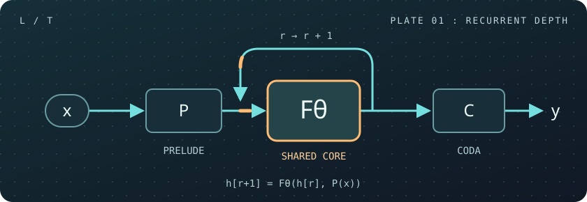

<a href="README.md">English</a> · <b>简体中文</b>

# Loop Transformer Atlas · 循环 Transformer 技术图谱

**只存一组权重，却能多算几轮。下一轮究竟买到了什么？**

[**打开中文交互图谱 →**](https://hyfine.github.io/loop-transformer-atlas/?lang=zh) · [技术导读](docs/guide.zh.md) · [方法案例手册](docs/routes.zh.md) · [证据与链接审阅](EVIDENCE.md)

循环 Transformer **沿深度**复用同一变换：权重可以不变，激活状态却在每轮变化。它不是智能体反复调用大模型，也不是生成更长的文字思维链。[SenseNova-Loop-9B 配置](https://huggingface.co/sensenova/SenseNova-Loop-9B/blob/main/config.json)很适合作为起点：**32 个独立层，执行 56 层次**。多出的 24 次执行来自重访中间块，而不是多保存了 24 层参数。

## 选择阅读入口

| 想弄清什么 | 从这里开始 |
|---|---|
| 十分钟建立直觉 | [算例、技术史与四组受控实验](docs/guide.zh.md) |
| 掌握全局 | [研究地图](https://hyfine.github.io/loop-transformer-atlas/?lang=zh#map)：家族树、泳道和时间轨迹可切换，保留当前作品。「分类速查」解释每类看什么对照、为什么归到这里。 |
| 看十一月在解决什么问题 | [前沿技术方向](https://hyfine.github.io/loop-transformer-atlas/?lang=zh#directions)：跨轮传什么、如何改造检查点、怎样少存或少搬 KV、怎样分配轮数。每个方向都列出已有证据和下一步验证方法。 |
| 深入一个实际模型 | [GLM-5.4](https://hyfine.github.io/loop-transformer-atlas/?lang=zh#frontier/glm) · [SenseNova-Loop-9B](https://hyfine.github.io/loop-transformer-atlas/?lang=zh#frontier/sense) · [Dory1.0-4B](https://hyfine.github.io/loop-transformer-atlas/?lang=zh#frontier/dory)。逐项对照执行路径、训练方式、缓存和实验条件。 |
| 跟踪一次代表性计算流程 | [A · 共享层能做什么](https://hyfine.github.io/loop-transformer-atlas/?lang=zh#lab/A) · [B · 训练循环模型](https://hyfine.github.io/loop-transformer-atlas/?lang=zh#lab/B) · [C · 决定循环几轮](https://hyfine.github.io/loop-transformer-atlas/?lang=zh#lab/C) · [D · 给已有模型加循环](https://hyfine.github.io/loop-transformer-atlas/?lang=zh#lab/D) · [E · 降低循环推理开销](https://hyfine.github.io/loop-transformer-atlas/?lang=zh#lab/E) · [F · 细化图、动作或世界状态](https://hyfine.github.io/loop-transformer-atlas/?lang=zh#lab/F) |
| 寻找论文、实现与权重 | [检索文献库](https://hyfine.github.io/loop-transformer-atlas/?lang=zh#library) · [一手资料手册](docs/routes.zh.md) · [逐链接访问记录](data/visits.csv) |

## 前沿手记 · 截至 2026 年 11 月 26 日

| 公开日期 | 进展 | 为什么值得看 |
|---|---|---|
| 11 月 25 日 | [Mixture-of-Loops Transformer](https://arxiv.org/abs/2611.34923v1) · [代码](https://github.com/hustvl/MoLT) | 跨轮可以传递更早位置的 KV 记忆，而非同位置的残差。这会改变哪些计算可以并行。 |
| 11 月 23 日 | [GLM-5.4](https://z.ai/blog/glm-5.4) · [LoopRes](https://arxiv.org/abs/2611.31094v2) | 两种存量改造：前者继续训练一个执行两遍的 28 层门控块，后者学习选择和读取前几轮的残差。证据分别来自厂商披露和预印本。 |
| 11 月 17–18 日 | [SenseNova-Loop-9B](https://github.com/OpenSenseNova/SenseNova-Loop) · [LoopCache](https://arxiv.org/abs/2611.24301v1) | 前者开放双流、中段共享的解码器；后者调度推测验证以减少长上下文 KV 访存。两者节省的不是同一种资源。 |
| 11 月 2–3 日 | [Dory1.0-4B 论文](https://arxiv.org/abs/2611.03998v1)／[权重](https://huggingface.co/nvidia/NVIDIA-Nemotron-Labs-Dory1.0-4B-BF16) · [ARLoop](https://arxiv.org/abs/2611.05234) | Dory 在可变深度下只保存最后一遍的历史 KV；ARLoop 在预训练时学习该读取哪些历史深度状态。 |

**值得记住的一组对照：** [Huginn](https://arxiv.org/html/2502.05171v2) 对*同一个检查点*增加推理深度，从 4 轮到 32 轮，ARC-Easy 从 49.07 升至 69.91。[LoopCoder-v2](https://arxiv.org/html/2606.18023v1) 的一至三轮是*分别训练的配置*，SWE-bench Verified 为 43.0 → 64.4 → 27.6。两项研究改变的实验变量不同，不能据此推出通用最优轮数。

## 收录边界与复用

六条路线收录 32 条研究或发布精读记录，另设含 333 条记录的发现索引。两者有重叠，**不能相加称为 365 种架构**。每条精读记录都标注一手证据与解读边界。[检索方法、种子归属与失效链接](EVIDENCE.md) · [贡献与本地运行](CONTRIBUTING.md) · [引用](CITATION.cff) · [许可](LICENSE)。
