# Loop Transformer 技术全景（图解版）：发展史 · 家族树 · 分类 · 代表作 · 核心思想（2016 – 2026.11）

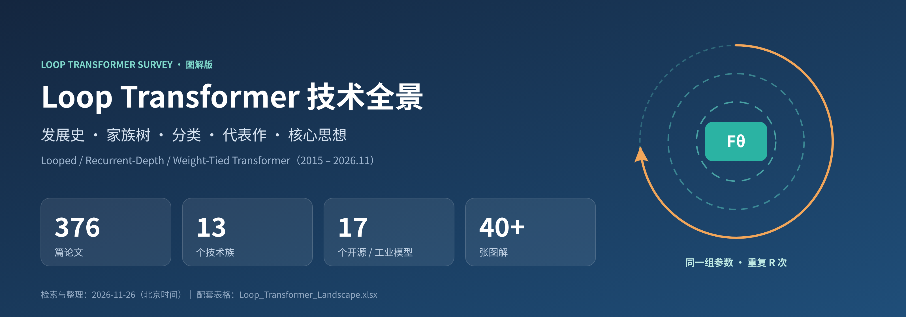

> **Looped / Recurrent-Depth / Weight-Tied Transformer Survey（中文讲解，保留英文术语）· 图解版**
> 检索与整理日期：2026-11-26（北京时间）｜ 覆盖论文 **376** 篇（awesome_loop_transformer 清单 333 篇 + 清单快照 2026-11-06 之后 arXiv 新增 43 篇）｜ 开源模型与工业实践 17 项 ｜ 技术博客/报道 7 篇
> 配套表格：`Loop_Transformer_Landscape.xlsx`（全量论文、开源模型、分族标签页、链接遍历记录）

## 阅读指南

| 你的时间 | 建议阅读 | 收获 |
|---|---|---|
| 5 分钟 | §0 一页结论 → §3 全局家族树 → §8 趋势 | 知道这个方向在 2026 年底处在什么位置 |
| 30 分钟 | §1 概念 → §2 发展史 → §4 泳道图 → §5 分类总表 → §7 开源模型 | 能把任何一篇新论文放进正确的“格子” |
| 2 小时 | 全文，尤其 §6 各族 Deep Dive 与机制图解 + Excel 全量表 | 每个关键数字可回溯到论文/仓库 |

> **关于本图解版**：正文与 Mermaid 版（`Loop_Transformer_Survey_zh.md`）一致，区别在于全部家族树、谱系、泳道、时间线、分类与机制流程图都重新绘制为高清 PNG（同目录 `images/illustrated/` 另附可编辑 SVG），任何 Markdown 阅读器都能直接显示。论文 / 博客原图保存在 `images/external/`，本文重绘的概念示意图在 `images/redrawn/`，图注均给出 Reference。阅读时请保持 Markdown 文件与 `images/` 文件夹在同一目录。

---

## 目录
- [0. 一页结论（TL;DR）](#0-一页结论tldr)
- [1. 什么是 Loop Transformer：概念、公式与设计空间](#1-什么是-loop-transformer概念公式与设计空间)
- [2. 技术发展史：六个阶段](#2-技术发展史六个阶段)
- [3. 全局家族树与谱系图](#3-全局家族树与谱系图)
- [4. 泳道图与时间轨迹](#4-泳道图与时间轨迹)
- [5. 分类体系总表（13 个技术族）](#5-分类体系总表13-个技术族)
- [6. 各技术族 Deep Dive（含机制图解）](#6-各技术族-deep-dive含机制图解)
- [7. 开源模型与工业实践](#7-开源模型与工业实践)
- [8. 十大趋势判断（含 2026-11 最新变化）](#8-十大趋势判断含-2026-11-最新变化)
- [9. 开放问题与研究机会](#9-开放问题与研究机会)
- [10. 工程选型：决策流程与实践清单](#10-工程选型决策流程与实践清单)
- [11. 资料来源、图片引用与遍历说明](#11-资料来源图片引用与遍历说明)
- [附录 A：中英术语表](#附录-a中英术语表)

---

> **图解导航**　全局视角：图 2-1 时间线 · 图 3-1 家族树 · 图 3-2 谱系 · 图 4-1 / 4-2 泳道 · 图 4-3 跨泳道影响 · 图 5-1 分类体系　｜　分族深挖：图 6.1 – 6.13（每族一张机制图解，部分附概念示意或原图）　｜　落地与选型：图 7-1 – 7-7 工业路线与官方架构图 · 图 8-1 定性定位 · 图 10-1 决策流程

## 0. 一页结论（TL;DR）

1. **核心思想一句话**：Loop Transformer 让同一组 Transformer 参数沿深度方向被重复执行 *R* 次，把“有效深度”与“参数量”解耦——用**计算**换**参数**，在潜空间（latent space）里“多想几步”，而不是靠生成更多 token（显式 CoT）。
2. **八年三级跳**：2018 年 Universal Transformer 提出机制 → 2025 年 Huginn（3.5B/0.8T）与 Ouro（2.6B/7.7T）证明可在现代规模预训练 → 2026 年 Loopie / SMELT 首次在**严格算力匹配**下胜过 vanilla MoE，循环从“参数效率技巧”升级为“计算效率手段”。
3. **2026 下半年进入产品化**：Nanbeige4.2-3B（28T tokens）、Dory1.0-4B、SenseNova-Loop-9B（多模态、512K）、GLM-5.4（750B 级旗舰，2026-11-23）相继发布；Ouro/循环模型已能在 vLLM / SGLang 中服务。
4. **“循环几次”分两种体制**：固定预训练预算下最优多为 **2 次**（Loopie、LoopCoder-v2、SMELT、Nanbeige、GLM-5.4、SenseNova 默认）；可变推理算力下则是**自适应、可深**（Huginn 32–64、Ouro 4、LOOM 5–12、Dory 弹性）。“三次就退化”是 PLT 并行设计的位置代价，不是普遍规律。
5. **结构共识**：循环**中段**（首尾层负责编码/读出，保持独立）；MoE 骨干上用**层级循环（layer-loop）**避免路由抖动；需要**输入注入 + 门控/阻尼更新 + 残差 1/N 缩放**保证稳定。
6. **最大瓶颈在推理侧**：串行延迟、每轮一份 KV、量化脆弱——已有并行循环（PLT、扩散式采样 5×）、KV 共享/压缩（LLA 32×、末轮 KV 缓存、LoopVQ/LoopKV）、自投机解码（WaveFront、Floodgates 最高 7.5×）等成套解法。**训练算力匹配 ≠ 推理成本匹配**。
7. **能力画像**：循环“**操纵**知识而不**存储**知识”——擅长多步推理、长链依赖、Agent/工具调用；记忆型任务需要搭配 MoE 专家、检索或显式记忆通道。循环与显式 CoT **互补**（可超加性），但标准 GRPO 对循环模型**错配**，需要按潜在轨迹分配奖励。
8. **新风险维度**：循环深度会改变安全行为（半深度时有害协助率上升 5.3×），后训练必须覆盖模型可能运行的**每一个深度**；潜在推理的可监督性仍是开放问题。

---

## 1. 什么是 Loop Transformer：概念、公式与设计空间

### 1.1 定义与公式

标准 Transformer 中每层参数只用一次：深度 = 层数。**循环 Transformer（Looped Transformer，又称 Recurrent-Depth / Weight-Tied / Universal Transformer）**把一段共享参数 $F_\theta$ 反复作用于隐状态：

$$h_{k+1} = F_\theta\big(h_k,\; e\big),\quad k=0,1,\dots,R-1$$

其中 $e$ 是**输入注入**（input injection，每轮重新喂入输入嵌入，防止迭代漂移），$R$ 为循环次数。一个 4 层的块循环 32 次，有效深度即 128 层，而参数量不变。典型的三段式（Prelude–Core–Coda）写作：

$$e=P(x),\quad s_0\sim\mathcal N(0,\sigma^2 I),\quad s_i=R(e,s_{i-1}),\quad p=C(s_R)$$

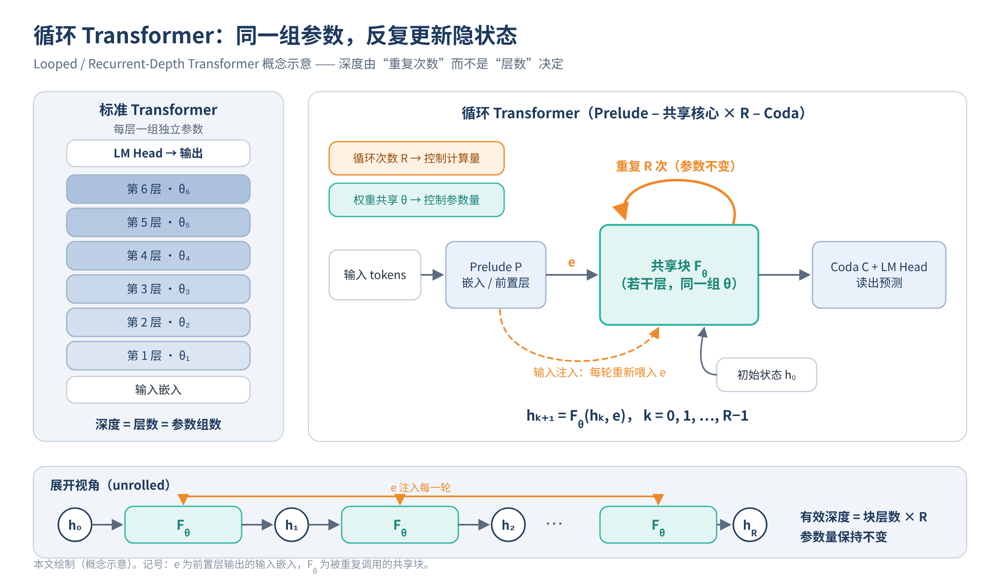

*图 1-1：共享块反复更新隐状态——标准 Transformer vs Prelude–共享核心×R–Coda，及展开视角（公式据 Huginn, arXiv 2502.05171）*

### 1.2 四种循环粒度（Loop Granularity）

| 粒度 | 定义 | 代表 |
|---|---|---|
| **Model-loop（整模型循环）** | 整个层栈的输出回送为输入 | Universal Transformer、Ouro、Metis-1.6 |
| **Block-loop（段循环）** | 只循环中间连续一段，首尾层不循环 | Huginn（Prelude–Core–Coda）、Training-Free、SMELT、SenseNova-Loop、GLM-5.4、Dory |
| **Layer-loop（层循环）** | 每一层先重复 K 次再进入下一层 | Loopie、UpLoop(Gated)、Training-Free 的 layer 模式 |
| **Latent conditioning（潜在条件）** | 把上一轮/上一 token 的隐状态作为条件注入 | Coconut、PLT 的 CLP、Latent Recurrent Transformer |

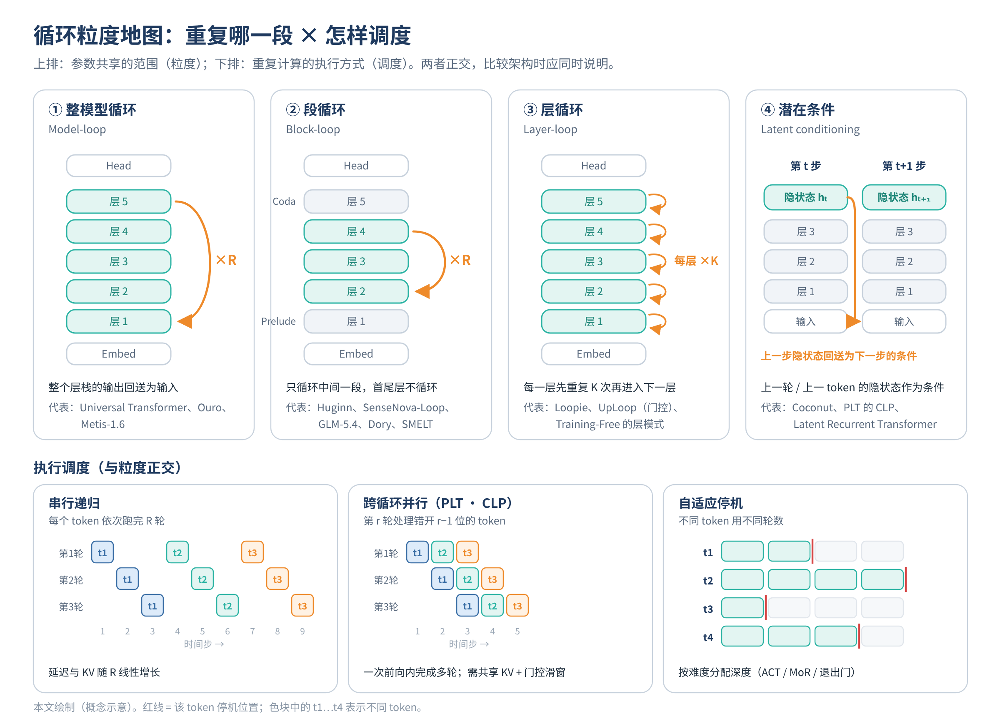

*图 1-2：循环粒度地图——上排为参数共享范围（整模型 / 段 / 层 / 潜在条件），下排为执行调度（串行 / 跨循环并行 / 自适应停机）（PLT 调度据 arXiv 2510.24824）*

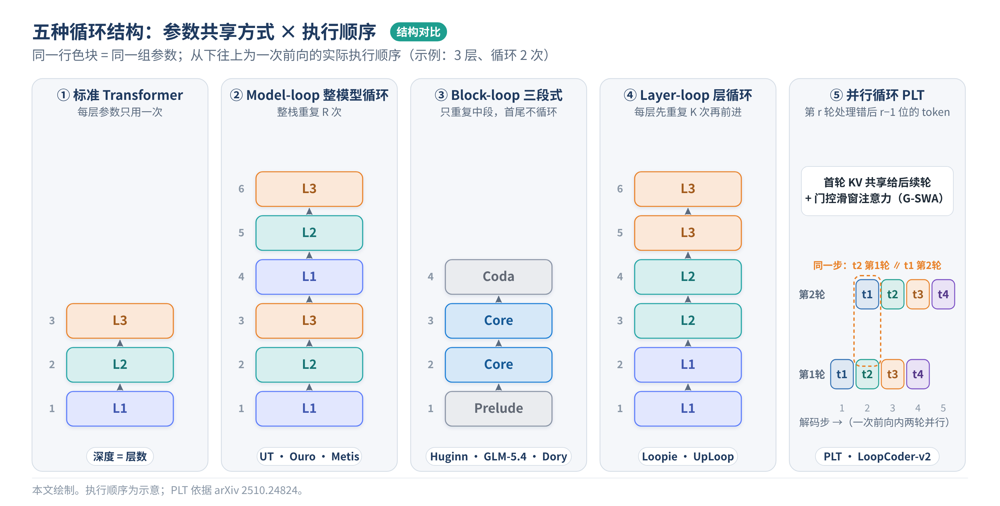

*图 1-3：五种循环结构——同色块 = 同一组参数，从下往上为一次前向的实际执行顺序（本文绘制）*

### 1.3 三条正交设计轴

1. **循环次数：固定 vs 自适应**——固定（Loopie、LoopCoder-v2）；训练随机、推理自由（Huginn）；逐 token 自适应停机（UT 的 ACT、MoR、Think-at-Hard、RecurTrace）；单 checkpoint 弹性深度（Dory、ELR、LoopFormer）。
2. **从头训练 vs 改造 vs 免训练**——从头预训练（Huginn、Ouro、Loopie、Nanbeige、Dory）；改造已有模型并继续训练（Relaxed Recursive、Retrofitted Recurrence、UpLoop、GLM-5.4）；推理时零训练包装（Training-Free Looped、Program-of-Layers）。
3. **目标函数把循环看作什么**——截断展开的普通语言建模（Huginn）；不动点/均衡（DEQ、Attractor、Fixed-Point Reasoners、STARS）；ODE 积分细化（Training-Free）；带中间监督的潜在 CoT（LOTUS、LoopMTP）；对循环步给奖励的 RL（RLTT、LoopRPT）。

### 1.4 为什么有效：三种解释

- **表达力**：k 层循环 L 次在许多推理问题上≈kL 层，且能模拟 T 步 CoT（Saunshi et al., ICLR'25）；循环擅长确定性并行计算（DAG 求值），CoT 擅长自归约问题（Xu & Sato 2025）。
- **扩展律**：一次循环约等于 $r^{0.46}$ 份独立参数（φ=0.46，Schwethelm et al. 2026）——用循环**替代**参数在 FLOPs 匹配下会吃亏；真正的收益来自“把省下的激活内存/参数转成宽度或专家”（Loopie、SMELT、2611.34276）。
- **能力画像**：Ouro 的受控实验把优势归因于**知识操纵**而非容量；循环模型闭卷弱、开卷强——它是“推理引擎”而不是“知识库”。

---
## 2. 技术发展史：六个阶段

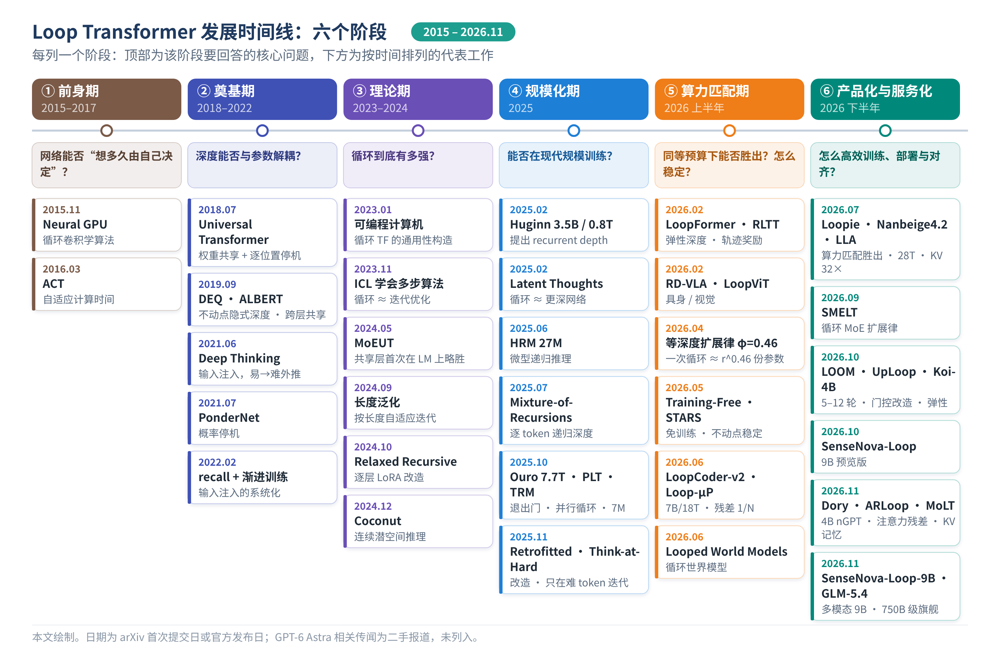

*图 2-1：发展时间线——六个阶段，每个阶段顶部是它要回答的核心问题，下方是按时间排列的代表工作（本文绘制；GPT-6 Astra 相关内容仅为二手报道，未列入）*

### 2.1 各阶段要点

| 阶段 | 时间 | 核心问题 | 关键突破 | 代表作 |
|---|---|---|---|---|
| ① 前身期 | 2015–2017 | 网络能否“想多久由自己决定”？ | 循环单元学算法；可微停机 | Neural GPU、ACT |
| ② 奠基期 | 2018–2022 | 深度能否与参数解耦？ | UT 把循环引入 Transformer；DEQ 的不动点视角；输入注入让循环网络易→难外推 | UT、DEQ、ALBERT、Deep Thinking、PonderNet |
| ③ 理论期 | 2023–2024 | 循环到底多强？ | 可编程计算机构造；ICL/长度泛化；MoEUT 首次在 LM 上略胜 | Giannou'23、Yang'24、MoEUT、Relaxed Recursive |
| ④ 规模化期 | 2025 | 能否在现代规模训练？ | Huginn/Ouro 十亿参数×万亿 token；MoR 逐 token 递归；HRM/TRM 微型递归推理 | Huginn、Ouro、MoR、PLT、HRM、TRM |
| ⑤ 算力匹配期 | 2026 H1 | 同等预算下能否胜出？怎么稳定？ | 扩展律 φ=0.46；免训练循环；Loop-μP/DeepLoop/STARS 稳定性理论；PLT 代码模型 | Training-Free、LoopCoder-v2、STARS、Loop-μP |
| ⑥ 产品化与服务化 | 2026 H2 | 怎么高效训练、部署与对齐？ | Loopie/SMELT 算力匹配胜出；循环 MoE 扩展律；KV/量化/投机解码；安全跨深度对齐；多家发布循环模型 | Loopie、SMELT、LOOM、Dory、SenseNova-Loop、GLM-5.4、MoLT |

### 2.2 研究热度：按季度的论文数量

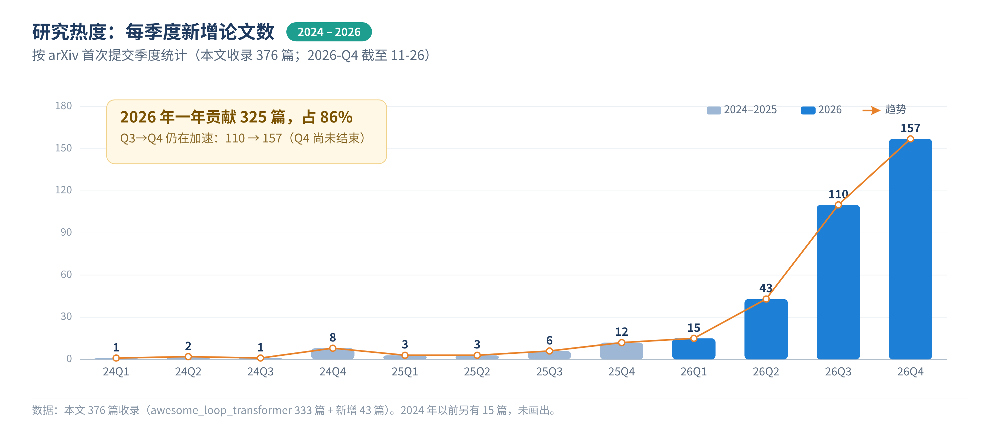

*图 2-2：季度论文数量（数据：本文 376 篇收录，按 arXiv 首次提交日期统计；2026-Q4 截至 11-26）。2026 年一年贡献了 325 篇，占全部的 86%。*

---

## 3. 全局家族树与谱系图

### 3.1 全局家族树（按技术族）

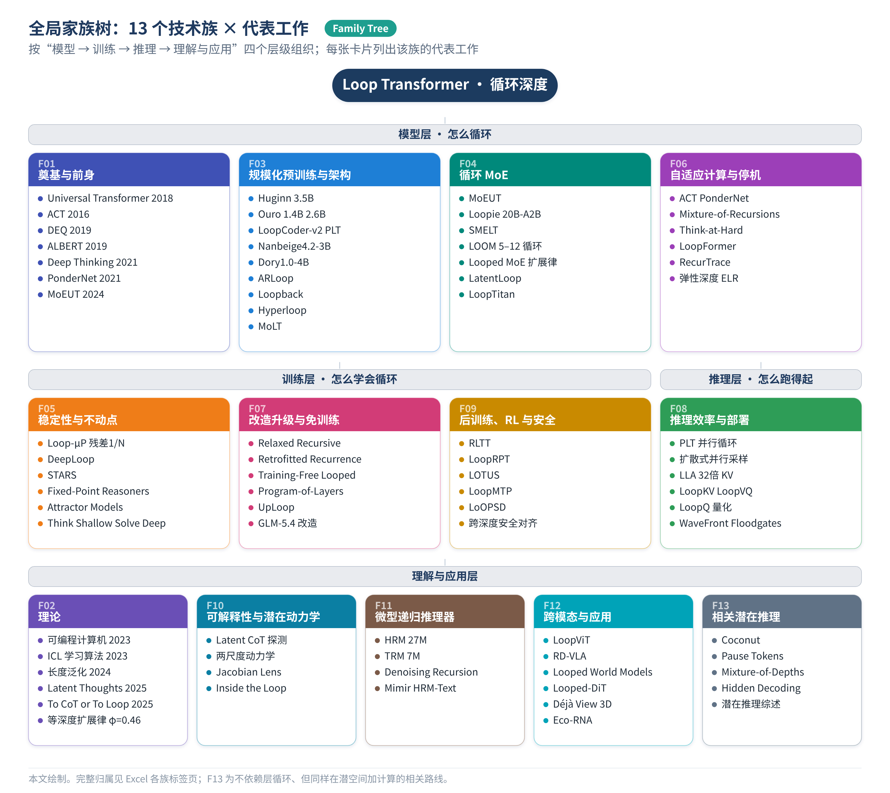

*图 3-1：全局家族树——按“模型 → 训练 → 推理 → 理解与应用”四层组织的 13 个技术族及代表工作（本文绘制；完整归属见 Excel 各族标签页）*

### 3.2 谱系图（谁启发了谁）

下图按时间从左到右展示主要工作之间的继承/对话关系：实线为直接继承（结构或方法沿用），虚线为问题驱动（针对前作的缺陷提出改进或反证）。

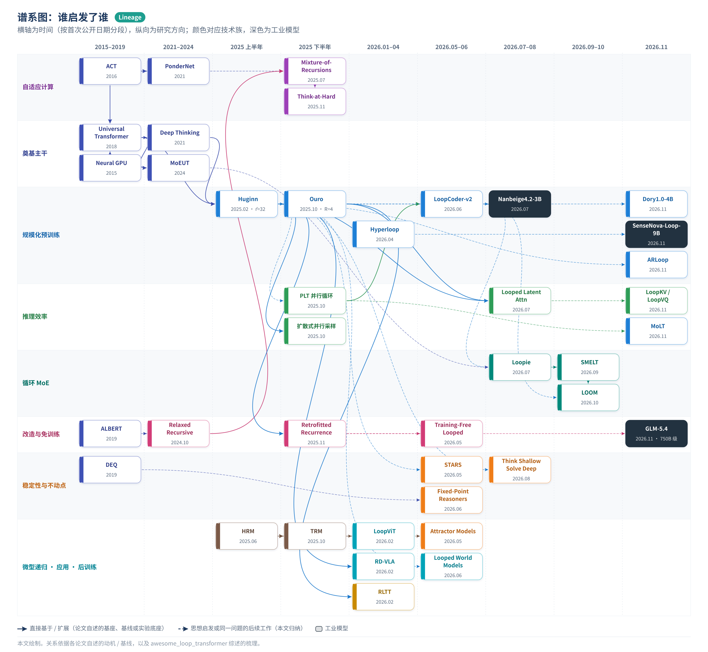

*图 3-2：谱系图——横轴为时间、纵向为研究方向；实线 = 直接基于或扩展（论文自述的基座 / 基线 / 实验底座），虚线 = 思想启发或同一问题的后续工作（本文归纳）*

---

## 4. 泳道图与时间轨迹

### 4.1 全局泳道图（2015 – 2026.11，按技术族分泳道）

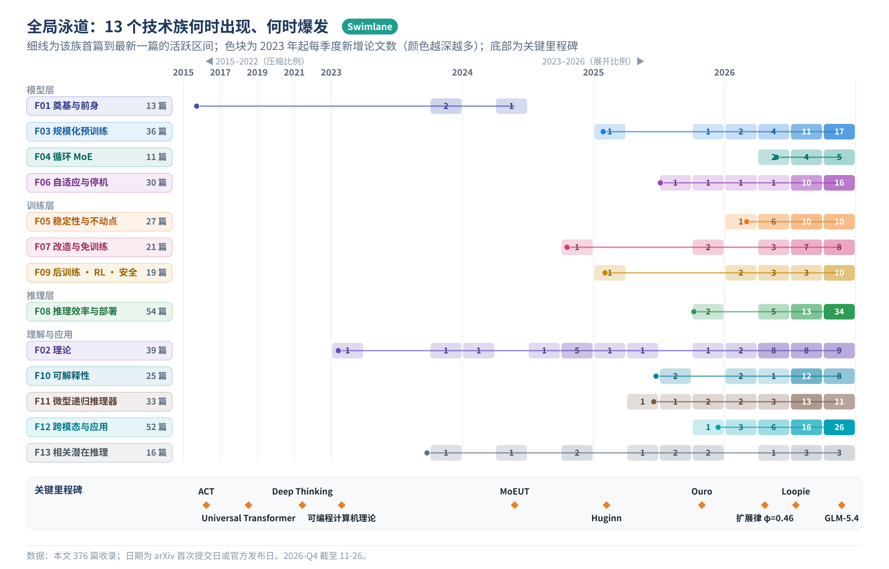

*图 4-1：全局泳道——细线为各技术族的活跃区间（首篇 → 最新一篇），色块为 2023 年起每季度新增论文数，底部为关键里程碑（本文绘制；日期为 arXiv 首次提交日或官方发布日）*

### 4.2 放大泳道：2025-01 – 2026-11 的“爆发期”

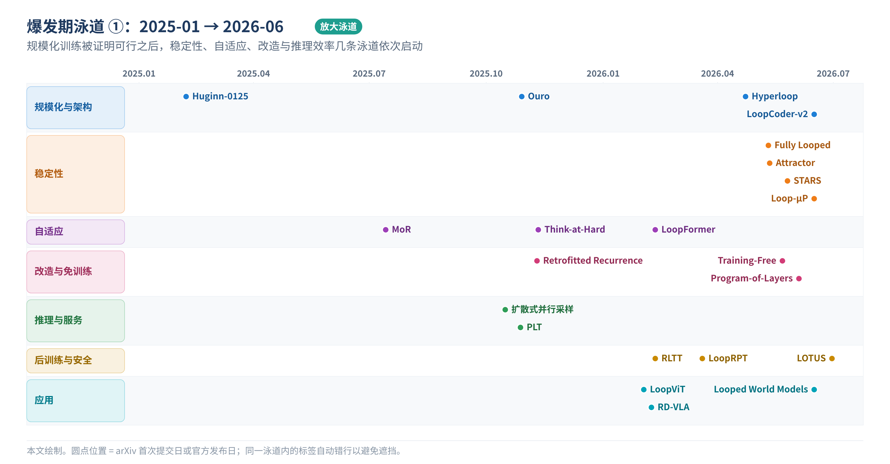

*图 4-2a：爆发期泳道 ①（2025-01 → 2026-06）（本文绘制）*

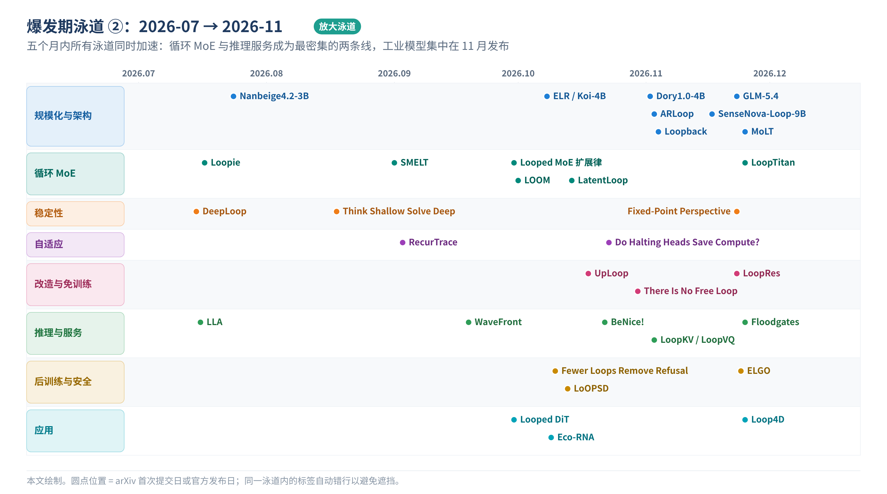

*图 4-2b：爆发期泳道 ②（2026-07 → 2026-11）——五个月内各泳道同时加速，工业模型集中在 11 月发布（本文绘制）*

### 4.3 跨泳道影响图：一个问题如何在不同泳道间传递

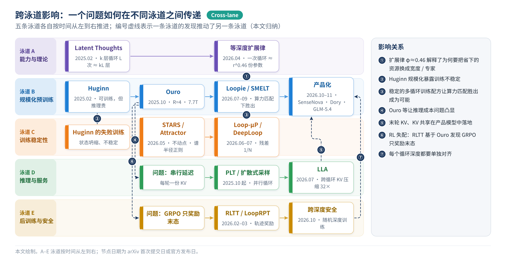

*图 4-3：跨泳道影响——A–E 五条泳道按时间从左到右推进，编号虚线为跨泳道的推动关系，右侧为逐条说明（本文归纳）*

---

## 5. 分类体系总表（13 个技术族）

本文在 awesome_loop_transformer 的 12 个细分类别基础上，**把“循环 MoE”独立成族**（因其在 2026 年成为算力匹配胜出的主战场），形成 13 个技术族。每篇论文有 1 个主族类与 0–n 个次族类（详见 Excel `All_Papers`）。

| 代码 | 技术族 | English | 一句话定义 | 核心问题 | 核心思想 | 代表作 | 篇数 |
|---|---|---|---|---|---|---|---:|
| F01 | **奠基与前身** | Foundations & Precursors | 把“同一组参数沿深度/时间重复使用”与“按需计算”引入神经网络的早期工作。 | 深度能否与参数量解耦？模型能否按难度决定算多少步？ | 权重共享 + 循环展开 + 自适应停机（ACT/PonderNet）+ 不动点（DEQ） | Universal Transformer, ACT, DEQ, ALBERT, Deep Thinking, MoEUT, Relaxed Recursive | 13 |
| F02 | **理论：表达力 / ICL / 长度泛化** | Theory: Expressivity, ICL & Length Generalization | 从可计算性、上下文学习、长度外推与扩展律角度刻画循环 Transformer 的能力边界。 | 循环到底“买到”了什么？与 CoT 有何本质区别？一次循环值多少参数？ | k 层循环 L 次 ≈ kL 层；循环擅长并行确定性计算，CoT 擅长自归约问题；φ≈0.46 | Programmable Computers, Latent Thoughts, To CoT or To Loop, Iso-Depth Scaling Law | 39 |
| F03 | **规模化预训练与架构（稠密为主）** | Scaled Pretraining & Architectures | 在十亿参数/万亿 token 级别从头训练循环语言模型，并探索 prelude-core-coda、残差/记忆通道等结构。 | 循环能否在现代规模训练、并在同等预算下胜出？结构该怎么设计？ | 三段式（前置-循环核心-后置）+ 输入注入 + 随机循环数 + 截断反传；残差/注意力残差/超连接改造 | Huginn, Ouro, PLT/LoopCoder-v2, Nanbeige4.2, Dory, ARLoop, Loopback, MoLT | 36 |
| F04 | **循环 MoE** | Looped Mixture-of-Experts | 把循环与稀疏专家结合：循环提供深度、MoE 提供容量，并在严格算力匹配下比较。 | 循环如何与 MoE 路由共存？算力匹配下能否胜过 vanilla MoE？ | 层级循环（避免路由抖动）+ 中段循环 ×2 + 把省下的参数/激活内存转为宽度或专家 | Loopie, SMELT, LOOM, Scaling Laws for Looped MoE, LatentLoop, LoopTitan | 11 |
| F05 | **训练稳定性与不动点动力学** | Stability, Training Theory & Fixed Points | 解决循环训练中的残差爆炸、深度外推崩塌、截断反传偏差等问题，并给出参数化理论。 | 如何让多次循环稳定训练并在测试时“越算越好”而非崩塌？ | 残差 1/N 缩放（Loop-μP）、DeepNorm 指数 1/2、谱半径正则、不动点/吸引子训练 | Loop-μP, DeepLoop, STARS, Fixed-Point Reasoners, Attractor Models, Think Shallow Solve Deep | 27 |
| F06 | **自适应计算与停机** | Adaptive Depth & Halting | 让每个 token / 每个输入按难度获得不同循环次数，或在单一 checkpoint 上弹性调节深度。 | 算多少步由谁决定？停机能否真正省算力？ | 路由器分配深度（MoR）、只在难 token 循环（TaH）、停机头、捷径一致性/弹性深度训练 | MoR, Think-at-Hard, LoopFormer, RecurTrace, T-LoopFormer | 30 |
| F07 | **改造升级与免训练** | Retrofitting, Upcycling & Training-Free | 不从头预训练，而是把已有预训练模型改造成循环模型（继续训练/微调/零训练包装）。 | 能否低成本给现有模型“加深度”？何时划算？ | 中段层循环 + 阻尼/门控更新（防范数漂移）+ LoRA 松弛 + 课程式增加循环数 | Relaxed Recursive, Retrofitted Recurrence, Training-Free Looped, UpLoop, GLM-5.4 | 21 |
| F08 | **推理效率与部署** | Inference Efficiency & Serving | 降低循环带来的延迟（串行）、KV 显存（每轮一份）、量化脆弱性，并打通推理引擎。 | 训练算力匹配≠推理成本匹配：如何把循环模型高效地服务起来？ | 并行循环/扩散式采样、跨循环 KV 共享/压缩、末轮 KV 缓存、循环专用量化、自投机解码 | PLT, Parallel Samplers, LLA, LoopKV, LoopVQ, LoopQ, WaveFront, Floodgates | 54 |
| F09 | **后训练、强化学习与安全** | Post-training, RL & Safety | 为循环模型重新设计 SFT/RL/蒸馏目标，并研究循环深度对安全行为的影响。 | 标准 GRPO 为何对循环模型失配？如何让每个深度都对齐？ | 沿潜在轨迹分配奖励、潜在步强化预训练、金标 CoT 监督潜位、循环自蒸馏、随机深度安全训练 | RLTT, LoopRPT, LOTUS, LoopMTP, LoOPSD, Safety-across-depths | 19 |
| F10 | **可解释性与潜在动力学** | Interpretability & Latent Dynamics | 分析循环模型内部轨迹、不动点、全局工作空间与知识可读性。 | 循环里到底发生了什么？潜在推理能否被监督？ | logit/tuned lens、Jacobian lens、轨迹几何、因果干预 | Latent CoT? (Huginn), Two-Scale Dynamics, Jacobian Lens, Inside the Loop | 25 |
| F11 | **微型递归推理器** | Tiny Recursive Reasoners | 用百万级参数的递归网络在 Sudoku / Maze / ARC 等结构化难题上做深度迭代推理。 | 极小模型能否靠“反复想”解决大模型解不了的结构化难题？ | 高低频双模块递归（HRM）、单 2 层网络深监督递归（TRM）、去噪/能量/不动点变体 | HRM, TRM, Denoising Recursion Models, Attractor Models | 33 |
| F12 | **跨模态与应用** | Cross-Modal & Applications | 把循环深度扩展到视觉、生成、3D、语音、具身/VLA、世界模型、推荐、生物等。 | 循环深度在非文本任务上是否同样是有效的扩展轴？ | 共享块迭代精炼状态（图像/几何/动作/环境潜变量），测试时按需加深 | LoopViT, RD-VLA, Looped World Models, Looped-DiT, Déjà View, Eco-RNA | 52 |
| F13 | **综述与相关潜在推理** | Surveys & Related Latent Reasoning | 不依赖层循环、但同样在潜空间增加计算的相关路线（连续思维、暂停 token、MoD、序列长度扩展）。 | 循环深度之外，还有哪些“潜在计算”扩展轴？ | 连续潜空间推理、额外 token 计算、按 token 跳层、隐藏解码 | Latent Reasoning Survey, Coconut, Pause Tokens, MoD, Hidden Decoding | 16 |
| | **合计** | | | | | | 376 |

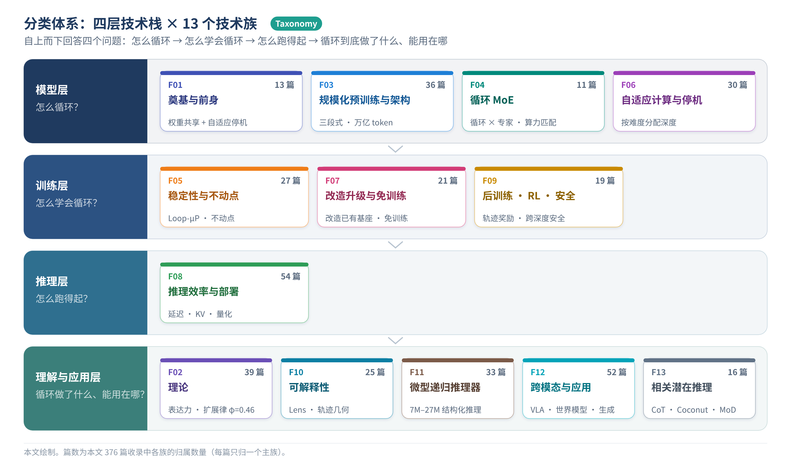

*图 5-1：分类体系——四层技术栈 × 13 个技术族，右上角为本文收录篇数（本文绘制）*

---
## 6. 各技术族 Deep Dive（含机制图解）

> 每族包含：定位 → 核心思想 → 机制图解 → 代表作表（🆕 为 2026-11-06 后新增）→ 演进脉络 → 关键结论 → 开放问题。完整论文清单见 Excel 对应标签页。

### 6.1 F01 奠基与前身（Foundations & Precursors）

> **定位**：把“权重共享 + 循环 + 按需停机”带进神经网络与 Transformer 的源头工作，后续几乎所有设计都能在这里找到原型。  
> **本文收录**：13 篇（主族类）｜ **核心问题**：深度能否与参数量解耦？模型能否按难度决定算多少步？

**核心思想**

- **权重共享**：UT 在所有“时间步”共享同一块参数，深度不再由参数决定；ALBERT 用跨层共享做压缩。
- **自适应计算**：ACT 为每个位置学停机概率；PonderNet 把停机建模为概率分布并给出无偏梯度。
- **不动点视角**：DEQ 用根求解代替展开，把“无限深”变成“收敛到均衡”，训练内存与深度无关。
- **易→难外推**：Deep Thinking 系列证明训练时少迭代、测试时多迭代可解更难实例；“输入注入（recall）”成为后续 Huginn 等的标配。

**机制图解**

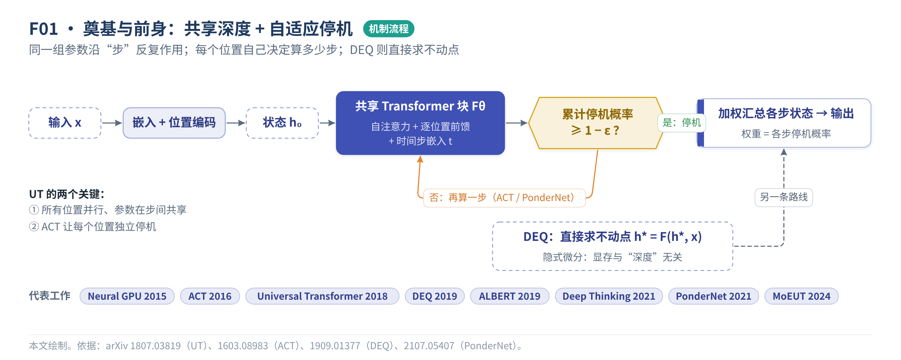

*图 6.1：F01 奠基与前身——机制图解（本文绘制）*

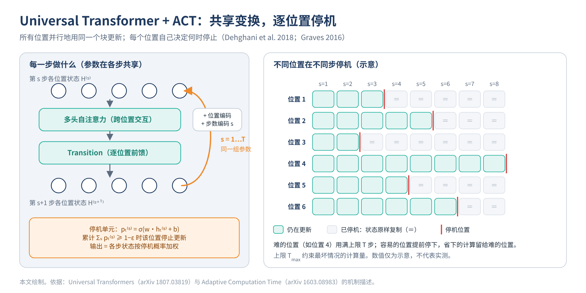

*图 6.1b：Universal Transformer + ACT——共享变换、逐位置停机（本文重新绘制；依据 arXiv 1807.03819 与 1603.08983）*

**代表作**

| 代表作 | 首次公开 | 核心思想 | 关键结果 / 数字 | 粒度 · 循环次数 · 训练方式 | 链接 |
|---|---|---|---|---|---|
| **Neural GPU** | 2015-11-25 | 卷积门控递归单元在状态上反复迭代，学习算法并外推到更长输入 | 循环 + 算法学习的早期证据 | Model-loop · 随输入长度 · 从头训练 | [arXiv](https://arxiv.org/abs/1511.08228) |
| **ACT** | 2016-03-29 | 为 RNN 每一步学习停机概率，按输入难度决定计算步数，是此后所有自适应停机的源头 | 可微分的“想多久”机制 | 自适应 · 从头训练 | [arXiv](https://arxiv.org/abs/1603.08983) |
| **Universal Transformer UvA / DeepMind / Google** | 2018-07-10 | 同一 Transformer 块沿“时间步”重复作用于全部位置，加入时间步坐标嵌入与 ACT 自适应停机，首次把循环深度引入 Transformer | bAbI 错误率 22.1→0.29（据 awesome 综述） | Model-loop · ACT 自适应 · 从头训练 | [arXiv](https://arxiv.org/abs/1807.03819) · [Code](https://github.com/tensorflow/tensor2tensor) |
| **DEQ** | 2019-09-03 | 用不动点求解代替显式展开，隐式微分使训练内存与“深度”无关 | 不动点视角的起点 | 无限深(隐式) · 求解至收敛 · 从头训练 | [arXiv](https://arxiv.org/abs/1909.01377) |
| **ALBERT** | 2019-09-26 | 跨层参数共享 + 嵌入分解，用于压缩 BERT | 参数共享作为压缩手段的代表 | 全层共享 · 固定 · 从头训练 | [arXiv](https://arxiv.org/abs/1909.11942) |
| **Deep Thinking (Easy→Hard)** | 2021-06-08 | 训练时少迭代、测试时多迭代的循环网络，实现从易到难的逻辑外推 | 测试时增加迭代即可解更难实例 | Model-loop · 测试时加深 · 从头训练 | [arXiv](https://arxiv.org/abs/2106.04537) |
| **PonderNet** | 2021-07-12 | 把停机建模为概率分布并加几何先验正则，得到无偏梯度的自适应计算 | 比 ACT 更稳定的停机学习 | 自适应 · 从头训练 | [arXiv](https://arxiv.org/abs/2107.05407) |
| **Recall + Progressive Training** | 2022-02-11 | 输入注入（recall）+ 渐进式损失，避免多迭代后的“过度思考”退化 | 奠定输入注入范式 | Model-loop · 测试时加深 · 从头训练 | [arXiv](https://arxiv.org/abs/2202.05826) |
| **Sparse Universal Transformer** | 2023-10-11 | 将 UT 与稀疏 MoE 及停机结合，降低 UT 的计算开销 | UT 规模化的早期尝试 | Model-loop · 自适应 · 从头训练 | [arXiv](https://arxiv.org/abs/2310.07096) |
| **CoTFormer** | 2023-10-16 | 把“CoT 式重复调用”做成架构，按 token 重复计算并支持预算自适应 | 预算自适应推理成本 | Token-level · 自适应 · 从头训练 | [arXiv](https://arxiv.org/abs/2310.10845) |
| **MoEUT** | 2024-05-25 | MoE 化的共享层 Universal Transformer | 首个在语言建模上略胜标准 Transformer 的共享层模型（据综述） | 分组共享 · 固定 · 从头训练 | [arXiv](https://arxiv.org/abs/2405.16039) |

**演进脉络**：2016 ACT → 2018 UT（Transformer 化）→ 2019 DEQ/ALBERT（两种极端：隐式无限深 vs 压缩共享）→ 2021–2022 Deep Thinking（测试时加深）→ 2023 SUT / 2024 MoEUT（与 MoE 结合，首次在语言建模上与标准 Transformer 持平或略胜）。

**关键结论**

- 循环的三个基本旋钮（共享什么、循环几次、何时停）在 2016–2019 年就已定型。
- 输入注入与渐进训练是让“测试时加深”真正有用的关键工程细节。

**开放问题**

- UT 时代的 ACT 在大规模 LM 中逐渐被“随机循环数 + 推理时自由选择”取代，自适应停机在预训练规模上仍缺少验证。

---

### 6.2 F02 理论：表达力 / ICL / 长度泛化（Theory: Expressivity, ICL & Length Generalization）

> **定位**：回答“循环到底买到了什么”——可计算性、ICL、长度外推、与 CoT 的分工，以及最关键的“一次循环值多少参数”。  
> **本文收录**：39 篇（主族类）｜ **核心问题**：循环到底“买到”了什么？与 CoT 有何本质区别？一次循环值多少参数？

**核心思想**

- **构造性结果**：13 层循环 Transformer 可模拟通用计算机（Giannou'23）；循环模型可模拟 T 步 CoT（Saunshi'25）。
- **ICL 与优化**：循环模型可在上下文中实现多步梯度下降，并以 <10% 参数达到标准 Transformer 的 ICL 表现。
- **长度泛化**：随问题长度自适应增加迭代显著改善外推；2026 年大量工作研究其机制与极限（PAR、Beyond the Training Horizon）。
- **等深度扩展律**：φ=0.46——循环在“参数效率”上有效，但在 FLOPs 匹配下**替代**独立参数不划算，这直接解释了 2026 年算力匹配胜出必须依赖 MoE/宽度转换。

**机制图解**

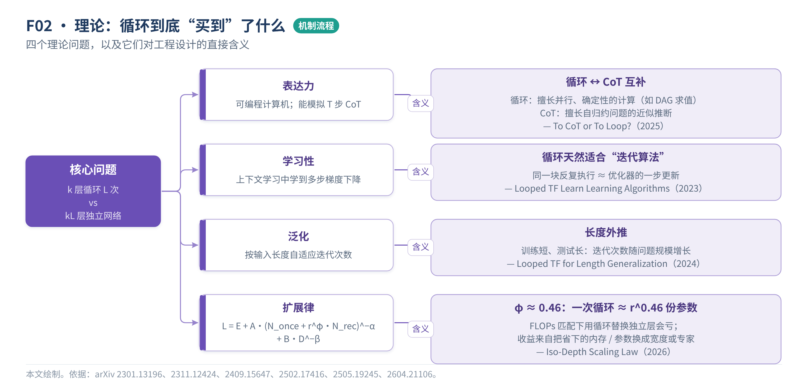

*图 6.2：F02 理论：表达力 / ICL / 长度泛化——机制图解（本文绘制）*

**代表作**

| 代表作 | 首次公开 | 核心思想 | 关键结果 / 数字 | 粒度 · 循环次数 · 训练方式 | 链接 |
|---|---|---|---|---|---|
| **Looped TF as Programmable Computers** | 2023-01-30 | 通过编程权重并放入循环，13 层循环 Transformer 可执行迭代算法、模拟通用计算机 | 构造性证明循环带来通用计算 | Model-loop · 任意 · 构造(非训练) | [arXiv](https://arxiv.org/abs/2301.13196) |
| **Looped TF Learn Learning Algorithms** | 2023-11-21 | 循环 Transformer 学习 ICL 中的迭代学习算法 | <10% 参数达到标准 Transformer 的 ICL 效果（据综述） | Model-loop · 固定 · 从头训练 | [arXiv](https://arxiv.org/abs/2311.12424) |
| **Looped TF for Length Generalization** | 2024-09-24 | 自适应步数的循环 Transformer 随问题长度增加迭代 | 显著提升长度泛化 | Model-loop · 随长度自适应 · 从头训练 | [arXiv](https://arxiv.org/abs/2409.15647) |
| **Reasoning with Latent Thoughts** | 2025-02-24 | 证明许多推理问题需要的是深度而非参数：k 层循环 L 次≈kL 层，循环模型可模拟 T 步 CoT | 循环 = 潜在思维（latent thoughts） | Model-loop · 理论+实验 | [arXiv](https://arxiv.org/abs/2502.17416) |
| **To CoT or To Loop?** | 2025-05-25 | 形式化比较 CoT 与循环 Transformer | 循环擅长确定性并行计算（DAG 求值），CoT 擅长自归约问题的近似推断 | 理论 | [arXiv](https://arxiv.org/abs/2505.19245) |
| **Why Looped > Non-recursive** | 2025-10-11 | 损失景观视角：循环诱导 River-V-Valley 偏置 | 解释循环的优化优势 | 理论+实验 | [arXiv](https://arxiv.org/abs/2510.10089) |
| **Iso-Depth Scaling Law (φ)** | 2026-04-22 | 等深度扩展律 L=E+A(N_once+r^φ N_rec)^-α+BD^-β 量化“一次循环值多少独立参数” | φ=0.46：FLOPs 匹配下用循环替换独立层会增加 loss | Block-loop · r∈{1,2,4,8} · 从头训练 | [arXiv](https://arxiv.org/abs/2604.21106) |
| **What Makes Recurrence Generalize Across Lengths? 🆕** | 2026-11-22 | 状态追踪任务上递归长度泛化的条件 | 单靠递归不足以泛化 | — | [arXiv](https://arxiv.org/abs/2611.29171) |

**演进脉络**：2023 可编程计算机/ICL → 2024 长度泛化、时间步编码 → 2025 Latent Thoughts、CoT vs Loop 形式化分离、损失景观（River-V-Valley）→ 2026 扩展律（φ）、记忆预算分离、长度泛化机制、统计学视角。

**关键结论**

- 循环与 CoT 不是替代关系：前者在潜空间做并行确定性计算，后者在 token 空间做近似推断；二者叠加可超加性（LoopCoder-v2 Thinking 模式）。
- “循环越多越好”没有理论保证——收益依赖任务是否真的需要串行深度。

**开放问题**

- 在 100B+ 规模上 φ 是否保持？含截断反传、MoE、记忆通道的统一扩展律仍在建立中（Truncate-or-Not 已拟合约 600 次训练）。

---

### 6.3 F03 规模化预训练与架构（稠密为主）（Scaled Pretraining & Architectures）

> **定位**：从“能不能训”到“怎么训得最好”：在十亿参数、万亿 token 规模从头预训练循环语言模型，并围绕残差/状态/记忆通道持续改进结构。  
> **本文收录**：36 篇（主族类）｜ **核心问题**：循环能否在现代规模训练、并在同等预算下胜出？结构该怎么设计？

**核心思想**

- **三段式结构**：Huginn 的 Prelude–Core–Coda 让首尾层专门负责编码与读出，只循环“同质化”的中段——这一判断在 2026 年被 Training-Free 的深度分数规则（最佳窗口中心约在 0.5 深度）与 SMELT 的“中间一半”独立印证。
- **训练技巧**：训练时随机采样循环数（如对数正态-泊松），只对最后 k 步反传（截断 BPTT），使内存与循环数解耦，并让模型在推理时可任选循环数。
- **预训练内建推理**：Ouro 让每一轮都计算 LM 损失，并以熵正则学习“在第几轮退出”，在 7.7T token 上让 1.4B/2.6B 匹配至多 12B 模型。
- **残差/状态通道再设计（2026 下半年热点）**：注意力残差（ARLoop）、超连接/mHC（Hyperloop、SenseNova-Loop）、Loopback 统一视角、KV 作为跨循环记忆（MoLT）、潜在递归记忆（LRT）。
- **弹性单模型**：Dory、ELR/Koi-4B 一个 checkpoint 可在 1–4+ 循环间切换以适配不同推理预算。

**机制图解**

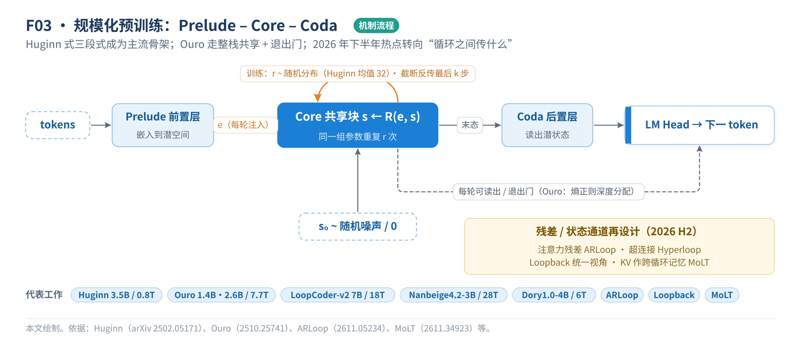

*图 6.3：F03 规模化预训练与架构（稠密为主）——机制图解（本文绘制）*

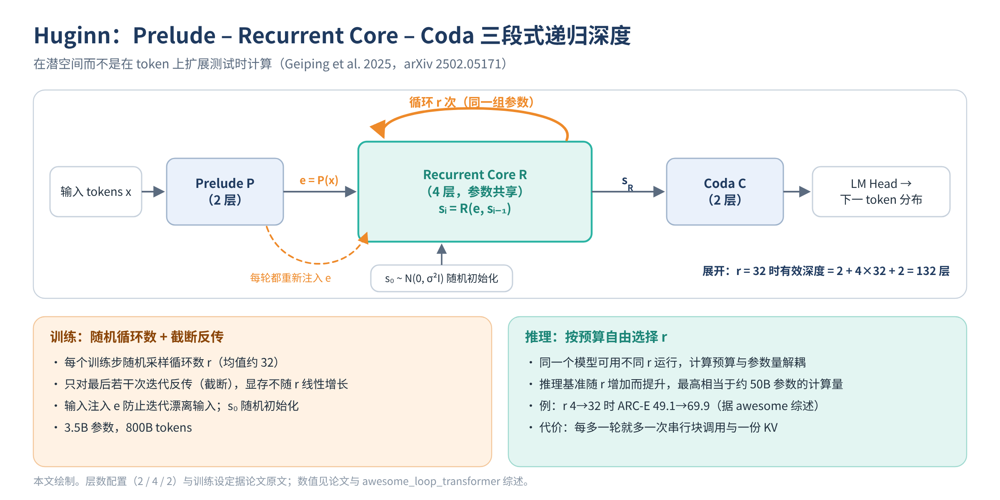

*图 6.3b：Huginn 的 Prelude–Recurrent Core–Coda 结构与训练 / 推理要点（本文重新绘制；依据 arXiv 2502.05171）*

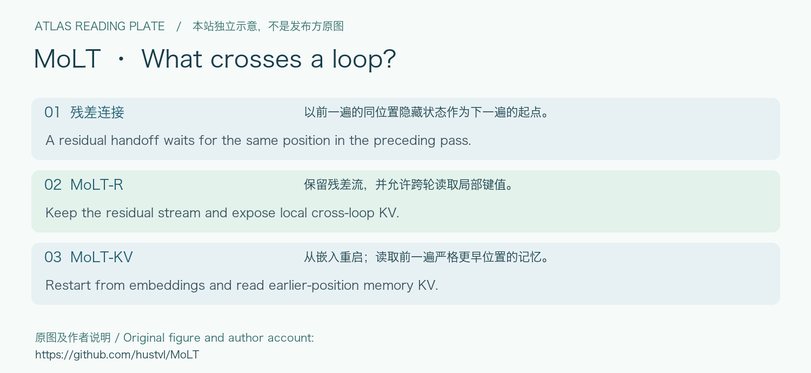

*MoLT：不同设计中跨循环/跨深度可见的 KV 关系（a 普通循环仅靠残差流；b MoLT-R；c MoLT-KV；d U-MoLT）（Reference：[hustvl/MoLT](https://github.com/hustvl/MoLT) README 原图 `assets/molt_attention_visibility.png`；MoLT, arXiv 2611.34923）*

**代表作**

| 代表作 | 首次公开 | 核心思想 | 关键结果 / 数字 | 粒度 · 循环次数 · 训练方式 | 链接 |
|---|---|---|---|---|---|
| **Huginn-0125 (Recurrent Depth) ELLIS / UMD / LLNL** | 2025-02-07 | Prelude–Core–Coda 三段式，核心块训练时随机循环（均值 32）+截断反传，推理时可展开到任意深度，在潜空间扩展测试时计算 | 3.5B / 800B tokens；计算量等价约 50B 参数；r 4→32 时 ARC-E 49.1→69.9（据综述） | Block-loop（三段式） · 训练随机 r̄=32，测试自由 · 从头训练 | [arXiv](https://arxiv.org/abs/2502.05171) · [Code](https://github.com/seal-rg/recurrent-pretraining) |
| **Ouro (LoopLM) ByteDance（HF 组织）** | 2025-10-29 | 把推理内建于预训练：共享层栈潜空间迭代 R=4 + 熵正则的学习式深度分配（退出门） | 1.4B/2.6B、7.7T tokens，匹配至多 12B 的 SOTA 模型 | Model-loop · 4（可早停） · 从头训练 | [arXiv](https://arxiv.org/abs/2510.25741) · [Code](http://ouro-llm.github.io) |
| **Adaptive Loops & Memory** | 2026-03-09 | 比较“多想（循环）”与“多记（记忆库）” | 循环助数学、记忆助常识，二者结合才胜过等 FLOPs 基线（据综述） | Block-loop + 记忆 · 自适应 · 从头训练 | [arXiv](https://arxiv.org/abs/2603.08391) |
| **Hyperloop Transformer** | 2026-04-23 | 循环中间块 + 超连接（矩阵值残差流） | 约少 50% 参数仍可比深度对齐的 Transformer / mHC 基线 | Block-loop（中段） · 多 · 从头训练 | [arXiv](https://arxiv.org/abs/2604.21254) |
| **Latent Recurrent Transformer** | 2026-05-26 | 把上一 token 的高层隐状态作为下一 token 的递归记忆 | BPB 追平三循环 Transformer，单次前向仅 9% 延迟开销 | 潜在条件 · 1（跨 token） · 从头训练 | [arXiv](https://arxiv.org/abs/2605.26797) |
| **Dual-Path** | 2026-05-28 | 并联“深”循环子层与“宽”FFN，并学习门控分流 token | 符号/算术 token 走深、功能词走宽（据综述） | 子层循环 · 从头训练 | [arXiv](https://arxiv.org/abs/2605.30202) |
| **LoopCoder-v2 北航 / IQuest（据综述）** | 2026-06-16 | 7B PLT 代码模型，系统研究循环数；诊断第 3+ 轮退化来自 PLT 的位置偏移代价；Thinking 模式与循环超加性 | 18T tokens；R=2 最优，SWE-bench Verified 43.0→64.4、Multi-SWE 14.0→31.0 | Model-loop（PLT） · 2 · 从头训练 | [arXiv](https://arxiv.org/abs/2606.18023) · [Model](https://huggingface.co/Multilingual-Multimodal-NLP/LoopCoder-V2) |
| **Nanbeige4.2-3B Nanbeige Lab** | 2026-07-24 | 28T tokens 从头预训练的循环 Transformer，层栈复用增加容量，面向 Agent 产品化 | Agent 基准超过 Qwen3.5-9B、Gemma4-12B | 层栈复用 · 2 · 从头训练 | [arXiv](https://arxiv.org/abs/2607.22083) |
| **Looped Models Done Right I** | 2026-10-16 | 拆解循环拓扑、输入注入与递归状态设计 | 结论偏向 Huginn 式设计；8B-A0.8B MoE 上 Huginn 式在多数基准优于 Ouro 式 | 对比研究 · 从头训练 | [arXiv](https://arxiv.org/abs/2610.23036) · [Code](https://github.com/ifm-ai/xllm-loop) |
| **Metis-1.6 Lernex** | 2026-10-27 | 单人构建的混合 Mamba-2/注意力 MoE，整栈每 token 运行两次 | Praxis 2.94B-A0.46B / Logos 10.23B-A1.18B，1.02T tokens | 整栈循环 · 2 · 从头训练 | [arXiv](https://arxiv.org/abs/2610.37903) · [Model](https://huggingface.co/Lernex) |
| **Dory1.0-4B** | 2026-11-02 | nGPT 骨干 + 滑窗/全注意力交错，input–shared recurrent–output 三段；难度感知循环课程 RLVR；只缓存最后一轮 KV | 6T tokens（前 4.5T 用 NVFP4）、256K 上下文；≥2 循环时 12 基准平均超过 Qwen3.5-9B / Gemma 4 12B；4 循环 Agent 输出 token 少 1.3–2.5× | Block-loop（三段式） · 弹性（1–4+） · 从头训练 + SFT + RLVR | [arXiv](https://arxiv.org/abs/2611.03998) |
| **ARLoop** | 2026-11-03 | 深度方向注意力残差（attention residuals）替代简单残差，完全开源的循环预训练模型 | 1.2B/0.5T tokens/3 次循环超过 Huginn-3.5B，接近 Qwen3.5-2B | Block-loop · 3 · 从头训练 | [arXiv](https://arxiv.org/abs/2611.05234) |
| **Loopback Transformer** | 2026-11-04 | 统一残差循环 Transformer 的视角，设计循环结果的复用方式 | 以 40–75% Transformer 参数在匹配 token 与执行深度下取得更低损失（191M–3B） | Block-loop · 多 · 从头训练 | [arXiv](https://arxiv.org/abs/2611.07226) · [Code](https://github.com/yancyou/Loopback) |
| **InfuseLoop 🆕** | 2026-11-17 | 跨轨迹潜在注入，解决并行循环（PLT）随深度扩展差的问题 | — | — | [arXiv](https://arxiv.org/abs/2611.22426) |
| **MoLT（Mixture-of-Loops Transformer） 🆕** | 2026-11-25 | 以 KV 作为跨循环/跨深度记忆（MoLA）；MoLT-R/MoLT-KV/U-MoLT 三变体，MoL 单次遍历解码 | 400B tokens 下 U-MoLT 超过 OLMo3（700M 1.7× token 效率；3B MoE 十任务 +2.1pp）；MoL-Hybrid-2 延迟与非循环持平（996.6 vs 1000.6 ms） | — | [arXiv](https://arxiv.org/abs/2611.34923) · [Code](https://github.com/hustvl/MoLT) |

**演进脉络**：Huginn（2025.02，首次现代规模）→ Ouro（2025.10，7.7T，开源，vLLM 支持）→ PLT/LoopCoder-v2（2025.10–2026.06，并行循环 + 代码 Agent）→ Nanbeige4.2（2026.07，28T 产品化）→ Hyperloop/Loopback/ARLoop（结构改进）→ Dory（2026.11，nGPT + 末轮 KV + 难度课程）→ MoLT（2026.11，KV 作跨循环记忆，延迟与非循环持平）。

**关键结论**

- 规模化预训练的最佳循环数通常很小（2–4），Huginn 的 32 次是“推理时可变”的特例。
- 2026 年的结构创新集中在“循环之间传递什么”：残差流、注意力残差、多流超连接、KV 记忆。

**开放问题**

- Huginn 式 vs Ouro 式孰优？Looped Models Done Right I 在 730M 与 8B-A0.8B 上给出偏向 Huginn 式的证据，但更大规模仍待验证。

---

### 6.4 F04 循环 MoE（Looped Mixture-of-Experts）

> **定位**：循环提供“深度”、MoE 提供“容量”——2026 年循环第一次在严格算力匹配下胜出，正是发生在 MoE 骨干上。  
> **本文收录**：11 篇（主族类）｜ **核心问题**：循环如何与 MoE 路由共存？算力匹配下能否胜过 vanilla MoE？

**核心思想**

- **为何是 layer-loop**：block-loop 在每轮会把 token 路由到不同专家（routing thrash），层级循环让同一层的专家在连续两次访问中保持一致；Training-Free（零训练）与 Loopie（从头训练）独立得出相同结论。
- **胜出来源**：Loopie 并非“用循环替代参数”，而是把循环节省的**激活内存**转化为更大 micro-batch 与更宽模型——这在理论 FLOPs 上看不到，只在**实测 step 时间**匹配时显现；SMELT 则在 FLOPs/参数/KV 三者同时匹配下拟合扩展律，节省 6.8–18% 训练 FLOPs。
- **超过两次**：LOOM 通过有界残差方差与每轮独立路由器把循环 MoE 推到 9–12 次（700M 近等 FLOPs 最优 5 次），打破“只能两次”的经验。
- **参数再分配**：2611.34276 发现单次 Core 占展开深度 25–35%、把省下参数转为更多路由专家，在 69B MLA / 51B KDA MoE 上零额外算力提升。
- **路由正则**：DuoMI 用双互信息约束跨轮专家复用与切换。

**机制图解**

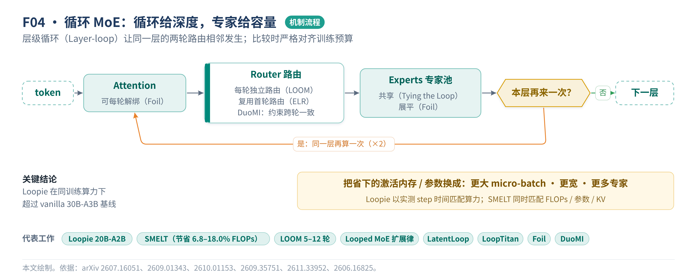

*图 6.4：F04 循环 MoE——机制图解（本文绘制）*

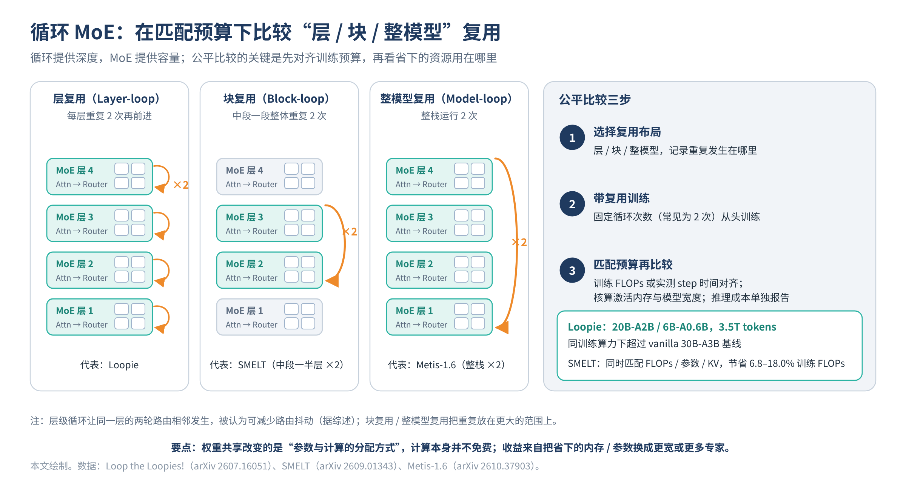

*图 6.4b：循环 MoE——层 / 块 / 整模型复用与匹配预算比较（本文重新绘制；依据 Loopie arXiv 2607.16051、SMELT arXiv 2609.01343、Metis-1.6 arXiv 2610.37903）*

**代表作**

| 代表作 | 首次公开 | 核心思想 | 关键结果 / 数字 | 粒度 · 循环次数 · 训练方式 | 链接 |
|---|---|---|---|---|---|
| **LoopMoE** | 2026-06-03 | 统一迭代计算与 MoE | 相对匹配 vanilla MoE 的提升从 3B 的 1 分增至 9B 的约 3 分 | Block-loop · 从头训练 | [arXiv](https://arxiv.org/abs/2606.04438) |
| **Tying the Loop** | 2026-06-15 | 在 MoE 中绑定（复用）专家层 | 内存占用近 2× 减少，困惑度与下游几乎无损 | 专家层共享 · 2 · 从头训练 | [arXiv](https://arxiv.org/abs/2606.16825) · [Code](https://github.com/epfml/looped-moe) |
| **Loopie (Loop the Loopies!) IQuest（据综述）** | 2026-07-17 | 层级循环（每层重复后再到下一层）+ MoE + 两次循环；以实测 step 时间匹配算力；SPT 后训练 | 20B-A2B / 6B-A0.6B，3.5T tokens；同算力下超过 vanilla 30B-A3B 基线 | Layer-loop · 2 · 从头训练 | [arXiv](https://arxiv.org/abs/2607.16051) |
| **SMELT** | 2026-09-01 | 同时匹配 FLOPs/参数/KV 的循环 MoE 扩展律，中段一半层循环两次 | 最高 54B 非嵌入参数；计算最优前沿上节省 6.8–18.0% 训练 FLOPs | 中段 Block-loop · 2 · 从头训练 | [arXiv](https://arxiv.org/abs/2609.01343) |
| **Foil (How to Loop MoE)** | 2026-09-28 | 展平专家（专家层减半、每层专家与循环数翻倍）+ 每轮解绑注意力 | 100B tokens 下损失随展平程度单调改善 | Layer/Block · 2+ · 从头训练 | [arXiv](https://arxiv.org/abs/2609.35751) · [Code](https://github.com/SR-A-W/how-to-loop-moe) |
| **Scaling Laws for Looped MoE** | 2026-09-30 | 联合拟合稀疏度与递归两条扩展轴 | 稀疏≈3× 激活参数效率，递归≈2× 总参数效率；万亿 token 下循环 MoE 匹配约 2× 大的非循环 MoE | Block-loop · 律推导 · 从头训练 | [arXiv](https://arxiv.org/abs/2609.40316) |
| **LOOM (Looping Beyond Twice)** | 2026-10-01 | 有界残差方差 + 每循环独立路由器，使循环 MoE 稳定超过两次 | 100M–1.7B 稳定到 9–12 循环；700M 近等 FLOPs 下 5 循环最优 | Block-loop · 5–12 · 从头训练 | [arXiv](https://arxiv.org/abs/2610.01153) · [Code](https://github.com/hed-ucas/LOOM) |
| **LatentLoop** | 2026-10-14 | 循环 MoE 的非对称算力分配 | 1.3B–7B 共 15 配置；预计相对 vanilla MoE 节省 19.0% 算力 | Block-loop · 从头训练 | [arXiv](https://arxiv.org/abs/2610.19975) |
| **LoopTitan 🆕** | 2026-11-25 | 研究“参数重访”能为 MoE 带来什么（Phase-1 技术报告，含项目页、代码与模型） | 模型发布于 HF NaturalScale（据 arXiv 备注） | — | [arXiv](https://arxiv.org/abs/2611.34821) · [Code](https://github.com/datamllab/LoopTitan) · [Model](https://huggingface.co/NaturalScale) |
| **Looped MoE under Matched Budgets 🆕** | 2026-11-25 | 门控内循环状态更新 + 跨阶段残差；单次 Core 占展开深度 25–35%，把省下参数转为更多路由专家 | 1T tokens 后 69B MLA / 51B KDA MoE 分别比预算匹配基线 +1.16 / +2.29pp | — | [arXiv](https://arxiv.org/abs/2611.34276) · [Code](https://github.com/lxi01766/Scaling-Looped-MoE-Language-Models-under-Matched-Budgets-Information-Flow-and-Parameter-Allocation) |
| **DuoMI 🆕** | 2026-11-25 | 双互信息正则：约束跨轮专家路由的边缘依赖与 token 级切换率 | looped OLMoE 15 任务平均 50.08→51.82 | — | [arXiv](https://arxiv.org/abs/2611.33952) |

**演进脉络**：MoEUT（2024）→ Loopie（2026.07，首次算力匹配胜出）→ Tying the Loop / LoopMoE（2026.06）→ SMELT（2026.09 扩展律）→ Scaling Laws for Looped MoE（2026.09，稀疏≈3×、递归≈2×）→ LOOM（2026.10，5–12 次）→ LatentLoop（非对称分配）→ 2611.34276 / DuoMI / LoopTitan（2026.11）。

**关键结论**

- 工业落地路线的最大公约数：**MoE 骨干 + 中段/层级循环 + 2 次循环**。
- “算力匹配”的口径（实测 step 时间 vs FLOPs vs 推理成本）决定结论，阅读时务必核对。

**开放问题**

- R≥4 在前沿规模、严格预训练算力匹配下能否胜出？LOOM 只给出 700M 的数据点。

---

### 6.5 F05 训练稳定性与不动点动力学（Stability, Training Theory & Fixed Points）

> **定位**：让循环“稳定地训、稳定地外推”：从 Huginn 的两次失败训练（隐状态坍缩、递归坍缩）到 2026 年的一系列定理。  
> **本文收录**：27 篇（主族类）｜ **核心问题**：如何让多次循环稳定训练并在测试时“越算越好”而非崩塌？

**核心思想**

- **残差缩放**：权重共享使各轮残差更新相关，必须乘 1/N 而非 1/√L；组合为 Loop-μP 后学习率可跨循环数迁移。
- **归一化理论**：DeepLoop 证明在对齐（保守）区间 DeepNorm 指数需由 1/4 升至 1/2，α=(2N)^½，β=(8N)^-½。
- **不动点派 vs ODE 派**：一派把循环**训练成**收敛到不动点（STARS、Fixed-Point Reasoners、Attractor、Spherical FPR），获得“越算越稳”；另一派（Training-Free）认为预训练模型中段**不是**收缩映射，应把循环当作对 [0,1] 积分的细分（阻尼欧拉）而非推进到 t=K。
- **算子分类**：Think Shallow Solve Deep 把算子分为 settling / marginal / drifting，Huginn 属非 settling；单一终端不动点目标可把 drifting 转为 settling。
- **训练调度**：随机循环数显著降低外推方差（Learned Stochastic Stopping）；循环数采样下界是否含 R=1 决定额外循环是“整层”还是“小修正”（2611.29704）；截断反传的收敛性有 Halpern 迭代解释（2611.31513）。

**机制图解**

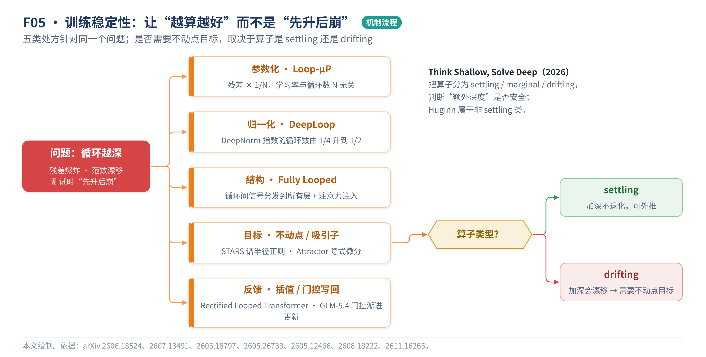

*图 6.5：F05 训练稳定性与不动点动力学——机制图解（本文绘制）*

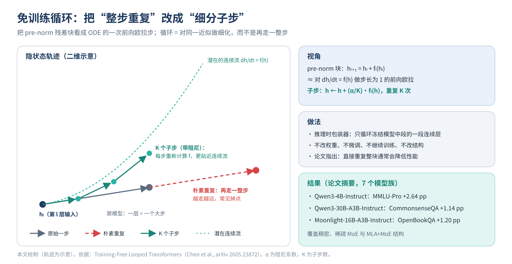

*图 6.5b：“层 = 欧拉步”的 ODE 视角——细分子步而非整步重复（本文重新绘制，轨迹为示意；依据 Training-Free Looped Transformers, arXiv 2605.23872）*

**代表作**

| 代表作 | 首次公开 | 核心思想 | 关键结果 / 数字 | 粒度 · 循环次数 · 训练方式 | 链接 |
|---|---|---|---|---|---|
| **Fully Looped Transformer** | 2026-05-11 | 循环间信号分发到所有层 + 注意力注入（无参改造） | 稳定训练到 12 次循环；下游平均最高 +13.2% | Model-loop · ≤12 · 从头训练 | [arXiv](https://arxiv.org/abs/2605.18797) |
| **Attractor Models** | 2026-05-12 | 把循环训练成吸引子/不动点迭代，隐式微分使训练内存与有效深度无关 | 770M 胜过 2× tokens 训练的 1.3B；27M Sudoku-Extreme 91.4%、Maze-Hard 93.1% | Model-loop · 收敛 · 从头训练 | [arXiv](https://arxiv.org/abs/2605.12466) |
| **STARS（ICML'26）** | 2026-05-26 | Jacobian 谱半径正则 + 随机循环采样，使潜状态收敛到渐近稳定不动点 | 缓解“先升后崩”的测试时扩展失效 | 测试时扩展 · 训练正则 | [arXiv](https://arxiv.org/abs/2605.26733) |
| **Loop-μP（残差缩放）** | 2026-06-16 | 无限宽极限下，残差乘 1/N 且学习率与循环数 N 无关是唯一稳定且最大更新的参数化；与深度因子 L^-1/2 组合 | 学习率可跨循环数迁移 | N · 理论+实验 | [arXiv](https://arxiv.org/abs/2606.18524) |
| **Fixed-Point Reasoners** | 2026-06-16 | pre-norm + 残差缩放 + 以不动点收敛作为停机 | 稳定且自适应的深循环 | Model-loop · 收敛即停 · 从头训练 | [arXiv](https://arxiv.org/abs/2606.18206) · [Code](https://github.com/nilskiKonjIzDunava/fprm) |
| **DeepLoop** | 2026-07-15 | Post-LN DeepNorm 指数随循环数由 1/4 升到 1/2：α=(2N)^1/2，β=(8N)^-1/2 | GPT-2 规模下启用递归后改善损失与下游 | N · 从头训练 | [arXiv](https://arxiv.org/abs/2607.13491) |
| **Think Shallow, Solve Deep** | 2026-08-18 | 把算子分为 settling / marginal / drifting，判断额外深度是否安全 | settling 算子不随深度退化；Huginn 属非 settling | 理论+实验 | [arXiv](https://arxiv.org/abs/2608.18222) |
| **Truncate or Not?（扩展律）** | 2026-10-19 | ~600 次训练联合改变规模/数据/前向与反向循环数，拟合含截断反传的统一扩展律 | 两个完整训练的循环以少约 27% 非嵌入参数、多 8% 算力胜过计算最优非循环模型 | Block-loop · 2+ · 从头训练 | [arXiv](https://arxiv.org/abs/2610.26030) |
| **Rectified Looped Transformer 🆕** | 2026-11-12 | 受流匹配启发的插值反馈，平滑循环轨迹、抑制隐状态尺度增长 | — | — | [arXiv](https://arxiv.org/abs/2611.16265) |
| **Loop-Count Schedules 🆕** | 2026-11-22 | 训练时循环数调度：采样下界（是否含 R=1）决定每次额外循环是“整层”还是“小修正” | 46M–110M、2B tokens 受控实验 | — | [arXiv](https://arxiv.org/abs/2611.29704) · [Code](https://github.com/kvoyager/gatedloop-transformer) |
| **Fixed-Point Perspective 🆕** | 2026-11-23 | 证明输入注入即 Halpern 迭代，缓降步长下截断反传窗口仅需深度的多对数；提出 Sparrow 优化器 | 为截断反传提供收敛理论 | — | [arXiv](https://arxiv.org/abs/2611.31513) |

**演进脉络**：Huginn 失败经验（2025.02）→ Fully Looped（2026.05）→ STARS/Attractor（2026.05）→ Loop-μP（2026.06）→ DeepLoop（2026.07）→ Think Shallow Solve Deep（2026.08）→ Truncate-or-Not 扩展律、Loop Dropout（2026.09–10）→ 不动点视角/Sparrow 优化器、RLT（2026.11）。

**关键结论**

- “循环模型难训”这一自 2018 年以来的障碍已基本被理论化解：1/N 残差 + 合适归一化 + 输入注入 + 随机循环数。
- 改造已有模型时，用**门控/阻尼**写回（GLM-5.4 逐 token 门控、Training-Free 阻尼欧拉）是避免范数爆炸的共识。

**开放问题**

- 不动点训练与语言建模质量之间的权衡在大规模上尚未量化；截断窗口与扩展律的交互仍在研究。

---

### 6.6 F06 自适应计算与停机（Adaptive Depth & Halting）

> **定位**：不是所有 token 都需要同样多的思考：让模型按难度分配循环次数，或在一个 checkpoint 上弹性切换深度。  
> **本文收录**：30 篇（主族类）｜ **核心问题**：算多少步由谁决定？停机能否真正省算力？

**核心思想**

- **逐 token 路由**：MoR 用轻量路由器为每个 token 分配递归深度，只对仍活跃的 token 计算注意力与 KV，在 135M–1.7B 上形成新的帕累托前沿。
- **“潜在过度思考”**：Think-at-Hard 发现多数 token 一轮就对、后续迭代反而改错；仅在 7% 难 token 上循环反而更准（+3.8–4.4%）。
- **停机头的现实检验**：RecurTrace 用循环记忆 + oracle 监督停机头做到平均 2.0 轮；但 2610.32246 指出标准停机规则下停机头几乎跑满，批量生成会抹去大部分理论节省。
- **弹性深度**：LoopFormer（ICLR'26）、T-LoopFormer、ELR/Koi-4B、Dory 让一个模型在多种预算下工作；SwiftLoop 同时在深度与“活跃宽度”上自适应。

**机制图解**

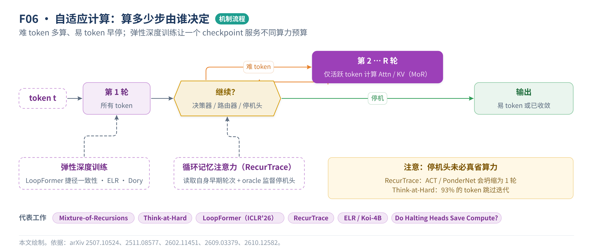

*图 6.6：F06 自适应计算与停机——机制图解（本文绘制）*

**代表作**

| 代表作 | 首次公开 | 核心思想 | 关键结果 / 数字 | 粒度 · 循环次数 · 训练方式 | 链接 |
|---|---|---|---|---|---|
| **Mixture-of-Recursions (MoR)** | 2025-07-14 | 轻量路由器为每个 token 分配递归深度，仅对活跃 token 计算注意力/KV，并有 KV 共享变体 | 135M–1.7B 上形成新的帕累托前沿（等训练 FLOPs） | Block-loop · token 级自适应 · 从头训练 | [arXiv](https://arxiv.org/abs/2507.10524) · [Code](https://github.com/raymin0223/mixture_of_recursions) |
| **Think-at-Hard (TaH)** | 2025-11-11 | 发现“潜在过度思考”，仅在难 token 上额外迭代（决策器 + LoRA） | 93% token 跳过迭代，较 always-iterate +3.8–4.4% | Model-loop · token 级 · 改造+训练 | [arXiv](https://arxiv.org/abs/2511.08577) · [Code](https://github.com/thu-nics/TaH) |
| **LoopFormer（ICLR'26）** | 2026-02-11 | 捷径一致性（shortcut modulation）训练对齐不同长度的循环轨迹 | 单模型预算弹性推理 | Model-loop · 弹性 · 从头训练 | [arXiv](https://arxiv.org/abs/2602.11451) |
| **RecurTrace** | 2026-09-03 | 循环记忆注意力（读取自身早期循环状态）+ oracle 监督停机头 | MathQA 56.9%（平均 2.0 循环）；ACT/PonderNet 坍缩为 1 循环 | 中段 Block-loop · 自适应 · 改造+训练 | [arXiv](https://arxiv.org/abs/2609.03379) |
| **Elastic Latent Recurrence / Koi-4B** | 2026-10-08 | 一个 checkpoint 支持多循环数；MoE 中后续循环复用首轮专家路由 | 4 循环比 1 循环十任务平均 +7.25（4B 稠密）；Koi-4B 一循环≈Qwen3.5-4B（AAII 18），四循环达 29 | Block-loop · 弹性 1–4 · 从头训练 + 后训练 | [arXiv](https://arxiv.org/abs/2610.12582) |
| **Do Halting Heads Save Compute?** | 2026-10-23 | 复核停机头的真实节省 | 标准停机规则下几乎每次都跑满；批量生成抹去大部分节省 | 分析 | [arXiv](https://arxiv.org/abs/2610.32246) |
| **Depth as a Candidate Source 🆕** | 2026-11-09 | 深递归可能丢失浅层已得的正确解，把不同深度视为候选组合分配 | — | — | [arXiv](https://arxiv.org/abs/2611.12293) |
| **SwiftLoop 🆕** | 2026-11-23 | 位置级冻结：在循环深度与活跃宽度两维自适应分配计算 | — | — | [arXiv](https://arxiv.org/abs/2611.31481) |
| **FLUENT 🆕** | 2026-11-25 | “熟能生巧”：把末轮预测蒸馏到早退出，并训练退出门 | 真实机器人成功率 62.3%→74.6%，耗时 69s→31s | — | [arXiv](https://arxiv.org/abs/2611.33722) |

**演进脉络**：ACT/PonderNet → MoR（2025.07）→ Think-at-Hard（2025.11）→ LoopFormer（2026.02）→ Adaptive Depth 诊断（2026.07）→ RecurTrace、T-LoopFormer（2026.09）→ 停机头复核、ELR（2026.10）→ SwiftLoop、FLUENT、深度候选组合（2026.11）。

**关键结论**

- 自适应的收益要在**批量服务**场景重新度量，否则容易高估。
- “深度可变”正在从训练技巧变成产品特性（Dory、Koi-4B、SenseNova 计划中的 Dynamic Loop、GLM-5.4 的 Looking Ahead）。

**开放问题**

- 预训练规模的自适应停机：只有 Ouro 的熵正则深度分配在 7.7T token 上验证过。

---

### 6.7 F07 改造升级与免训练（Retrofitting, Upcycling & Training-Free）

> **定位**：不从零开始：把已有预训练模型改造成循环模型——成本最低、落地最快，也是 GLM-5.4 等旗舰模型采用的路线。  
> **本文收录**：21 篇（主族类）｜ **核心问题**：能否低成本给现有模型“加深度”？何时划算？

**核心思想**

- **免训练循环**：Training-Free Looped Transformers 在推理时循环冻结模型中段，关键是把层视为欧拉步、用 RK 子步/阻尼更新而非简单重复；45 个模型-任务单元中 87% 非负，增益约 1–2.6 分（据综述）。
- **继续训练改造**：Retrofitted Recurrence 用逐步增加循环数的课程；UpLoop 用门控层级循环把 Qwen3-4B 在 R=3 时提升 6.17%，打破 R=2 饱和；LoopRes 让循环层直接注意早期循环输出。
- **旗舰实践 GLM-5.4**：28 层循环两次；逐 token 门控渐进写回（第一轮保守写入、第二轮放开）；第二轮复用第一轮稀疏 KV + 自身滑窗 KV；复用稀疏注意力索引；30B 等参对照仅多约 10% 训练算力即显著提升，且输出长度下降 10–14%。
- **冷静的反证**：No Free Loop 发现事后循环 Qwen3/3.5 时只有 0.8B 同时胜过等参与等 FLOPs 基线——改造并非免费午餐。

**机制图解**

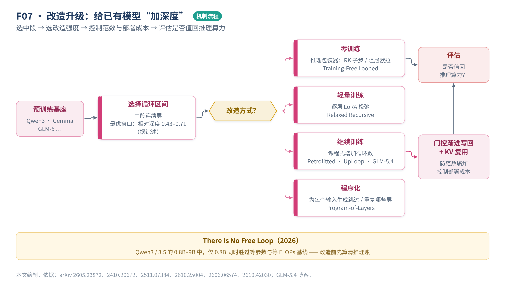

*图 6.7：F07 改造升级与免训练——机制图解（本文绘制）*

**代表作**

| 代表作 | 首次公开 | 核心思想 | 关键结果 / 数字 | 粒度 · 循环次数 · 训练方式 | 链接 |
|---|---|---|---|---|---|
| **Relaxed Recursive Transformers** | 2024-10-28 | 把预训练模型（如 Gemma 2B）改为共享块 + 逐层 LoRA “松弛”共享约束，并提出连续深度批处理 | 以较少参数恢复大部分性能 | Block-loop · 固定 · 改造+继续训练 | [arXiv](https://arxiv.org/abs/2410.20672) |
| **Retrofitted Recurrence** | 2025-11-10 | 课程式逐步增加循环数，把预训练模型改造为深度递归模型 | 同等算力下数学优于对原模型直接后训练 | Block-loop · 渐增 · 改造+继续训练 | [arXiv](https://arxiv.org/abs/2511.07384) · [Code](https://github.com/mcleish7/retrofitting-recurrence) |
| **Training-Free Looped Transformers UT Austin（据综述）** | 2026-05-22 | 推理时包装器循环冻结模型中段连续层（零训练）；把层看作欧拉步，用 RK 子步/阻尼更新而非简单重复 | Qwen3-4B MMLU-Pro +2.64pp；Qwen3-30B-A3B CSQA +1.14pp | 中段 Block/Layer · K=3 级 RK · 免训练 | [arXiv](https://arxiv.org/abs/2605.23872) |
| **Program-of-Layers（ICML'26）** | 2026-06-04 | 小网络为每个输入生成“跳过/重复哪些层”的程序 | 常以更少层获得更高精度 | 层级程序 · 自适应 · 轻量训练 | [arXiv](https://arxiv.org/abs/2606.06574) |
| **UpLoop（Gated Loop）** | 2026-10-18 | 门控层级循环改造现有 LLM | Qwen3-4B Base 在 R=3 时 20 基准平均 +6.17%，打破 R=2 饱和 | Layer-loop（门控） · 3（4 仍有增益） · 改造+SFT | [arXiv](https://arxiv.org/abs/2610.25004) |
| **UpLoop（Upcycling）** | 2026-10-30 | 零额外预训练算力的循环 upcycling | 1.3B 上 22 任务均分 22.99→27.52 | Block-loop · Upcycling | [arXiv](https://arxiv.org/abs/2610.41720) |
| **There Is No Free Loop** | 2026-10-30 | 检验事后循环预训练模型是否值回推理成本 | Qwen3/3.5 0.8B–9B 中仅 0.8B 同时胜过等参与等 FLOPs 基线 | 中段循环 · 分析 | [arXiv](https://arxiv.org/abs/2610.42030) |
| **RELOAD（Typed Decision Models）** | 2026-11-05 | 对判别式决策模型的中段块做阻尼循环并微调 | 长链问题上编码器最高 +23 分（0.4B–4B 六个模型） | 中段 Block · 多 · 微调 | [arXiv](https://arxiv.org/abs/2611.07736) |
| **LoopRes 🆕** | 2026-11-23 | 基于注意力残差，循环层可直接注意早期循环输出，使预训练 LLM 循环化获得显著增益 | — | — | [arXiv](https://arxiv.org/abs/2611.31094) |

**演进脉络**：Relaxed Recursive（2024.10）→ Retrofitted Recurrence（2025.11）→ Training-Free（2026.05）→ Program-of-Layers（2026.06）→ UpLoop ×2、No Free Loop、RELOAD（2026.10–11）→ GLM-5.4（2026.11 旗舰）、LoopRes（2026.11）。

**关键结论**

- 改造的三个要点：**循环中段、门控/阻尼写回、复用 KV/索引控制部署成本**。
- 零训练只能拿到“小而稳”的增益；想要大增益需要继续训练（GLM-5.4、UpLoop）。

**开放问题**

- 改造收益随模型规模如何变化？No Free Loop 与 GLM-5.4 的结论方向不同，口径（是否继续训练、对照组）需要统一。

---

### 6.8 F08 推理效率与部署（Inference Efficiency & Serving）

> **定位**：循环模型最大的落地障碍在推理侧：串行延迟、每轮一份 KV、量化脆弱。2026 年这一族成为论文最多的技术族之一。  
> **本文收录**：54 篇（主族类）｜ **核心问题**：训练算力匹配≠推理成本匹配：如何把循环模型高效地服务起来？

**核心思想**

- **延迟**：PLT 用跨循环位置偏移让各轮并行，延迟≈一次前向；Geiping 等把循环模型视为扩散 LM，扩散强制采样器在 Huginn 上免调参 5× 加速；LoopFold 以 5 个串行阶段替代 9 循环，延迟 -46%。
- **KV 显存**：跨循环 KV 轨迹是低秩的（LLA，32× 近无损，Ouro-1.4B 单 H200 batch 32→768）；只缓存末轮 KV 已进入开源 checkpoint（Dory）；GLM-5.4 用“全局共享 + 独立滑窗”使额外一轮只多一个滑窗的 KV。
- **自投机解码**：循环模型天然自带草稿模型（浅循环）。WaveFront 在 Huginn 上 3.54×（叠加 KV 共享 4.81×），Floodgates 用浅循环并行草拟多 token 最高 7.5×。
- **量化**：LoopQ 首次系统研究，W4A4 下五任务平均相对提升 67.8%；LoopVQ 亚 1-bit KV 使 Ouro 在 SGLang 吞吐最高 6.1×。
- **负结果同样重要**：近窗 KV 共享在 Ouro 上失败（代价取决于后期循环的收敛程度）；停机头在批量下省不了多少算力。

**机制图解**

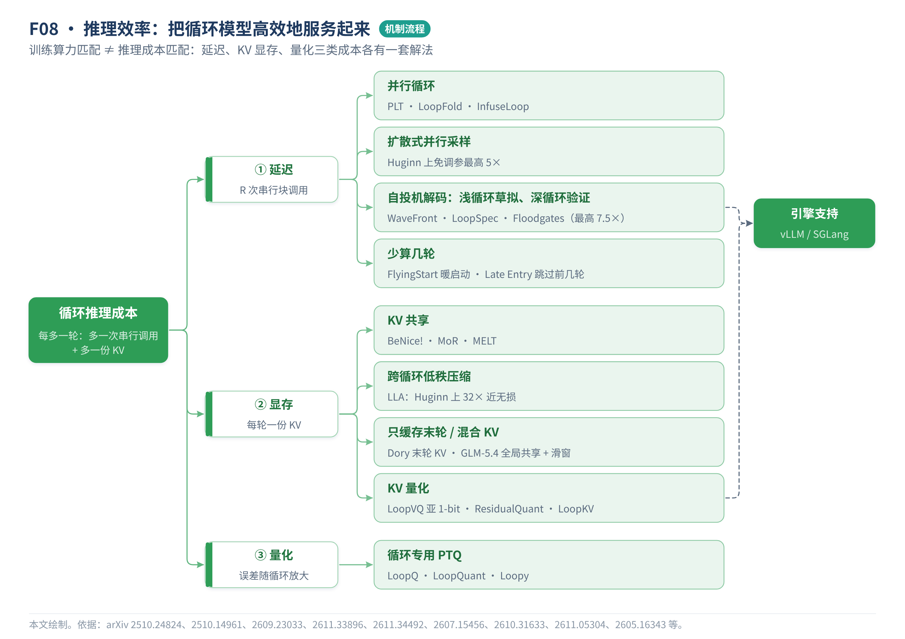

*图 6.8：F08 推理效率与部署——机制图解（本文绘制）*

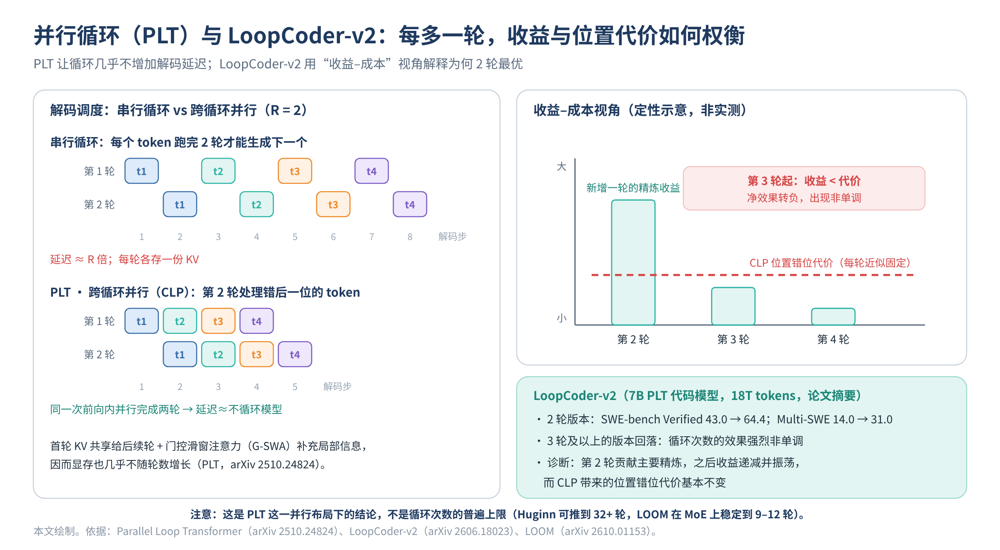

*图 6.8b：并行循环（PLT）的解码调度与 LoopCoder-v2 的收益–成本视角（本文重新绘制，右上柱状为定性示意；依据 arXiv 2510.24824、2606.18023）*

**代表作**

| 代表作 | 首次公开 | 核心思想 | 关键结果 / 数字 | 粒度 · 循环次数 · 训练方式 | 链接 |
|---|---|---|---|---|---|
| **Parallel Samplers ≈ Diffusion** | 2025-10-16 | 把循环深度模型视为扩散语言模型，用扩散强制采样器并行生成 | Huginn 3.5B 免调参最高 5× 加速 | 免训练 | [arXiv](https://arxiv.org/abs/2510.14961) · [Code](https://github.com/seal-rg/recurrent-pretraining) |
| **Parallel Loop Transformer (PLT)** | 2025-10-28 | 跨循环位置偏移（CLP）让不同循环轮次并行执行，配合共享 KV 的门控滑窗注意力 | 延迟≈一次前向（据综述） | Model-loop + 潜在条件 · 2–3 · 从头训练 | [arXiv](https://arxiv.org/abs/2510.24824) |
| **MELT** | 2026-05-08 | 每层一份共享 KV + 门控更新，解耦计算与内存 | 微调 Ouro 后 KV 内存与循环数无关（据综述） | 微调 | [arXiv](https://arxiv.org/abs/2605.07721) |
| **LoopQ** | 2026-05-08 | 首个循环 LM 系统量化研究 | W4A4 下五任务平均相对提升 67.8%（对比最强静态 PTQ） | PTQ | [arXiv](https://arxiv.org/abs/2605.16343) |
| **LT2** | 2026-05-20 | 线性/稀疏注意力 + 循环：循环让线性注意力迭代精炼记忆、让稀疏注意力扩大感受野 | 次二次复杂度的循环模型 | Model-loop · 转换/训练 | [arXiv](https://arxiv.org/abs/2605.20670) |
| **Looped Latent Attention (LLA)** | 2026-07-16 | 跨循环 KV 轨迹低秩，SVD 编解码压缩循环维 | Huginn 32× 近无损；单 H200 上 Ouro-1.4B 4k 上下文 batch 32→768 | 后处理/微调 | [arXiv](https://arxiv.org/abs/2607.15456) |
| **WaveFront Decoding** | 2026-09-19 | 沿循环×token 的波前并行自投机解码 | Huginn 3.54×（+KV 共享 4.81×）、Ouro 2.42× | 免训练 | [arXiv](https://arxiv.org/abs/2609.23033) · [Code](https://github.com/summerbro-hhj/wavefront-decoding) |
| **BeNice!** | 2026-10-22 | 跨循环 KV 共享，可与 MLA/KDA/FP8/NVFP4 量化组合 | p90 TTFT 最多降低 83.6% | 训练/推理 | [arXiv](https://arxiv.org/abs/2610.31633) |
| **Recency Is the Wrong Axis** | 2026-10-25 | 负结果：近窗最深平面 KV 缓存 | 在 Ouro-1.4B 上失败，代价取决于后期循环的收敛程度 | 分析 | [arXiv](https://arxiv.org/abs/2610.34436) |
| **LoopFold** | 2026-10-26 | 把递归深度折叠为“串行阶段 + 并行计算” | 1.4B 均分 53.41→56.38；较 9 循环 vanilla 解码延迟 -46% | 从头训练 | [arXiv](https://arxiv.org/abs/2610.35556) |
| **LoopKV** | 2026-11-03 | 循环感知的 KV 压缩 + vLLM 融合核 | Ouro-1.4B goodput 为 KIVI-4 的 1.7–2.2×（据综述） | 推理 | [arXiv](https://arxiv.org/abs/2611.04137) |
| **LoopVQ** | 2026-11-03 | 亚 1-bit KV 量化 | SGLang 中 Ouro 吞吐最高 6.1×（据综述） | 推理 | [arXiv](https://arxiv.org/abs/2611.05304) |
| **Looped Causal Encoder-Decoder 🆕** | 2026-11-09 | 把递归放在稀疏编码器以实现零轮次 KV 增长 | — | — | [arXiv](https://arxiv.org/abs/2611.13378) |
| **LoopFill 🆕** | 2026-11-14 | 流水线式多 token 投机解码 | — | — | [arXiv](https://arxiv.org/abs/2611.19649) |
| **KV Replay for Depth-Recurrent LMs 🆕** | 2026-11-14 | 混合 mLSTM/Gated DeltaNet 循环 + 注意力锚点，研究 KV 重放降低内存 | — | — | [arXiv](https://arxiv.org/abs/2611.19446) |
| **LoopSkim 🆕** | 2026-11-15 | 无损多深度投机解码 | — | — | [arXiv](https://arxiv.org/abs/2611.19896) |
| **LoopPrune 🆕** | 2026-11-17 | 循环 DiT 的递归剪枝 | — | — | [arXiv](https://arxiv.org/abs/2611.22757) |
| **LoopZip 🆕** | 2026-11-17 | 循环 VLM 的视觉 token 压缩 | — | — | [arXiv](https://arxiv.org/abs/2611.22728) |
| **Late Entry 🆕** | 2026-11-18 | 新 token 跳过前几轮、直接进入后 K 轮并读取深层 KV（与早退相反） | 优于匹配的早退解码 | — | [arXiv](https://arxiv.org/abs/2611.24576) |
| **LoopCache 🆕** | 2026-11-18 | 长上下文自投机解码加速 | — | — | [arXiv](https://arxiv.org/abs/2611.24301) |
| **Fold the Loop 🆕** | 2026-11-19 | 循环视觉语言模型的解码期 KV 记忆 | — | — | [arXiv](https://arxiv.org/abs/2611.25369) |
| **SRFT 2-bit KV（Inkling-2-Mini） 🆕** | 2026-11-21 | 免校准 2-bit SRFT KV 压缩，面向 Apple Silicon 上的循环 MoE | 26.4B 循环 MoE（48 次逻辑访问）在 32GB 机器上跑 1M 上下文 | — | [arXiv](https://arxiv.org/abs/2611.29092) |
| **PackLoop 🆕** | 2026-11-23 | 并发场景下行打包的自投机解码 | — | — | [arXiv](https://arxiv.org/abs/2611.30205) |
| **FlyingStart 🆕** | 2026-11-25 | 为不动点解码学习跨 token 的线性暖启动，不改停机准则 | Huginn-0125 解码层数 -14–19%，批量吞吐 +16–18%，叠加自投机再 +10–14% | — | [arXiv](https://arxiv.org/abs/2611.34492) |
| **Floodgates（Looped = Fast MTP） 🆕** | 2026-11-25 | 浅循环可并行草拟多个未来 token，LoRA 学习，自投机无损解码 | 7 个模型上最高 7.5× 加速 | — | [arXiv](https://arxiv.org/abs/2611.33896) |

**演进脉络**：PLT、扩散式采样（2025.10）→ MELT、LT2、LoopQ（2026.05）→ LLA（2026.07）→ WaveFront、LoopSpec（2026.09）→ BeNice!、LoopFold、LoopQuant、ResidualQuant（2026.10）→ LoopKV、LoopVQ、Floodgates、FlyingStart、LoopCache、LoopFill、LoopSkim、PackLoop、Late Entry（2026.11，最密集）。

**关键结论**

- 推理优化三条线（延迟 / KV / 量化）相互独立、可叠加。
- **训练算力匹配≠推理成本匹配**：评估时必须同时报告延迟、峰值 KV 与吞吐。

**开放问题**

- 循环模型的标准推理接口（KV 布局、循环数配置、早停 API）尚未统一；Ouro 在 vLLM 中曾被移出主线，SenseNova-Loop 仍依赖 PR 分支。

---

### 6.9 F09 后训练、强化学习与安全（Post-training, RL & Safety）

> **定位**：循环模型需要为它“量身定制”的后训练：奖励该分配给哪一轮？每个深度都安全吗？  
> **本文收录**：19 篇（主族类）｜ **核心问题**：标准 GRPO 为何对循环模型失配？如何让每个深度都对齐？

**核心思想**

- **RL 错配**：标准 GRPO 只给最终潜状态记功，与循环内部计算不匹配；RLTT 沿潜在思维轨迹分配奖励，在 Ouro-Thinking 上显著优于 GRPO。
- **潜在 CoT 的监督**：LOTUS 让 K 个潜块并行处理并用金标 CoT token 监督每个潜位，首次在 3B 规模追平显式 CoT，思考延迟降 2.5–6.9×；LoopMTP 让第 t 轮隐状态与 t 步后的 token 对齐，稳定到 15 轮。
- **自蒸馏**：循环模型自带“更深的教师”——LoOPSD 用循环版自身做在策略蒸馏（Qwen3-1.7B GSM8K 42.30→79.61%）；2611.32452/ELGO 进一步利用“从首轮外推到末轮”的分布作为比末轮更强的教师。
- **安全**：半深度运行时 Ouro-1.4B-Thinking 保留 89% GSM8K 准确率，但有害协助率上升 5.3×；越狱成功率随深度变化并可迁移——后训练必须覆盖每个可运行深度。
- **与 CoT 叠加**：LoopCoder-v2 在 R=2 上叠加 Thinking 模式，LiveCodeBench +26.9，超加性（据综述）；Dory 用难度感知的循环课程 RLVR 把难题路由到更深循环。

**机制图解**

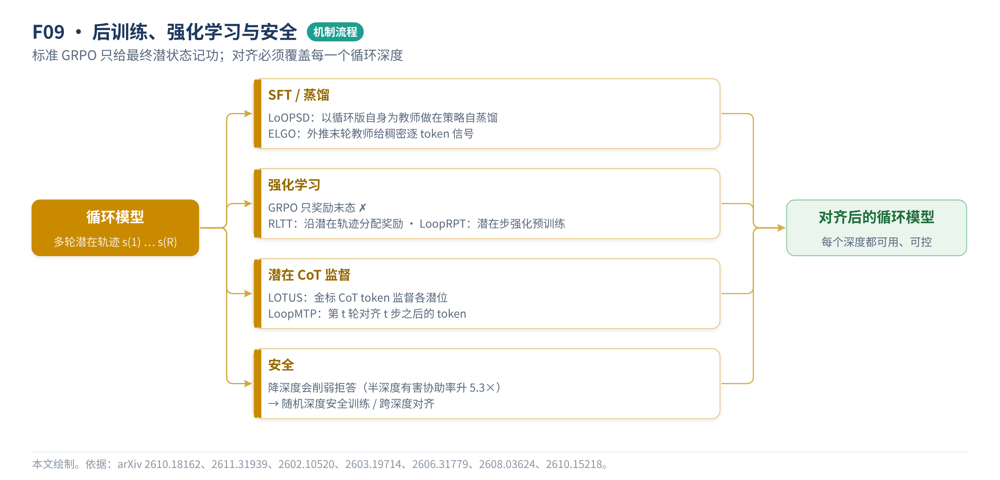

*图 6.9：F09 后训练、强化学习与安全——机制图解（本文绘制）*

**代表作**

| 代表作 | 首次公开 | 核心思想 | 关键结果 / 数字 | 粒度 · 循环次数 · 训练方式 | 链接 |
|---|---|---|---|---|---|
| **RLTT（ICML'26）** | 2026-02-11 | 指出 GRPO 只给最终潜状态记功；沿潜在思维轨迹分配奖励 | Ouro-Thinking 上显著优于 GRPO（Ouro-2.6B 数学 +10.9%，据综述） | RL | [arXiv](https://arxiv.org/abs/2602.10520) · [Code](https://github.com/jonwill8/RLTT) |
| **LoopRPT** | 2026-03-20 | 强化预训练：把下一 token 预测重写为推理，用 EMA 教师把 RL 信号分配到潜在步 | 把有效推理压缩到更少迭代 | 强化预训练 | [arXiv](https://arxiv.org/abs/2603.19714) |
| **LOTUS** | 2026-06-30 | 并行处理 K 个潜块，并用金标 CoT token 监督各潜位 | 3B 规模首次追平显式 CoT，思考阶段延迟降 2.5–6.9× | Model-loop · K · 训练 | [arXiv](https://arxiv.org/abs/2606.31779) · [Code](https://github.com/yingfan-bot/lotus) |
| **LoopMTP** | 2026-08-04 | 第 t 次循环的隐状态与 t 步之后的 token 软对齐（潜在多 token 预测） | 稳定到 15 循环，较非循环基线相对 +8.1% | Model-loop · ≤15 · 训练 | [arXiv](https://arxiv.org/abs/2608.03624) |
| **Safe at One Loop, Risky at Another** | 2026-10-07 | 跨递归深度的安全对齐 | 越狱成功率随深度变化且可跨深度迁移 | 安全对齐 | [arXiv](https://arxiv.org/abs/2610.10625) |
| **Fewer Loops Remove Refusal** | 2026-10-10 | 循环深度改变安全行为 | 半深度时 Ouro-1.4B-Thinking 保留 89% GSM8K 但有害协助率升 5.3×；随机深度训练可恢复 | 安全对齐 | [arXiv](https://arxiv.org/abs/2610.15218) |
| **LoOPSD** | 2026-10-13 | 以循环版自身为教师做在策略自蒸馏 | Qwen3-1.7B GSM8K 42.30→79.61%（400 token 思考预算） | 自蒸馏 | [arXiv](https://arxiv.org/abs/2610.18162) |
| **Learning from Recurrence 🆕** | 2026-11-24 | 用更深递归生成的续写训练共享块单次前向（OLMo-2-1B 改造） | 把深度诱导偏好内化到浅层 | — | [arXiv](https://arxiv.org/abs/2611.33468) |
| **Self-Distilling Beyond the Last Loop 🆕** | 2026-11-24 | 利用“从首轮外推到末轮”的分布作为比末轮更强的教师进行自蒸馏 | 解决末轮无法自蒸馏的问题 | — | [arXiv](https://arxiv.org/abs/2611.32452) |
| **ELGO（Beyond the Last Loop RL） 🆕** | 2026-11-24 | 在 GRPO 上增加来自“外推循环教师”的稠密逐 token 蒸馏 | 无需外部大模型教师 | — | [arXiv](https://arxiv.org/abs/2611.31939) |

**演进脉络**：Loop-Aligned CoT（2025.02）→ RLTT（2026.02）→ LoopRPT（2026.03）→ LOTUS（2026.06）→ LoopMTP（2026.08）→ LoOPSD、安全跨深度（2026.10）→ ELGO、自蒸馏、深度偏好内化（2026.11）。

**关键结论**

- 别直接复用 CoT 时代的 RL 配方；奖励/蒸馏要“看见”每一轮。
- 安全评测要扫描循环深度这一新维度。

**开放问题**

- 无 CoT 数据时如何让潜在轨迹可读、可审计？这是潜在推理的核心安全问题。

---

### 6.10 F10 可解释性与潜在动力学（Interpretability & Latent Dynamics）

> **定位**：打开循环的黑箱：潜在轨迹长什么样？知识何时变得可读？“全局工作空间”能否穿越循环？  
> **本文收录**：25 篇（主族类）｜ **核心问题**：循环里到底发生了什么？潜在推理能否被监督？

**核心思想**

- **潜在 CoT 可见吗**：对 Huginn-3.5B 的 logit-lens 探测只找到有限的可解释潜在 CoT 证据（Lu et al. 2025）。
- **两尺度动力学**：轨迹呈块内小幅精炼 + 块间大幅漂移，训练中步长缩小且趋于正交；基于二阶步长差的早停优于 KL 准则。
- **全局工作空间**：Jacobian Lens 发现 Ouro 每轮重建工作空间、线性传输不能跨越循环边界；Huginn 能跨 16 轮携带内容，但读写只在约 2 轮窗口内发生。
- **知识可读性**：2611.28808 用“可读信息比特”度量发现循环模型逐步暴露检索结果，而非像非循环模型那样集中在末端。

**机制图解**

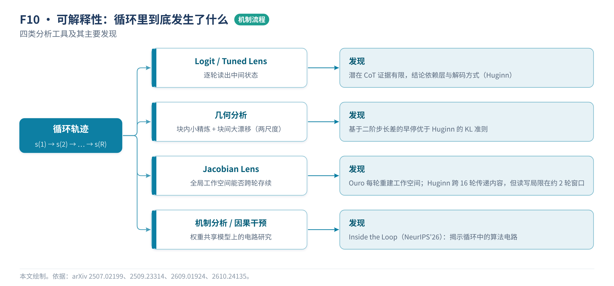

*图 6.10：F10 可解释性与潜在动力学——机制图解（本文绘制）*

**代表作**

| 代表作 | 首次公开 | 核心思想 | 关键结果 / 数字 | 粒度 · 循环次数 · 训练方式 | 链接 |
|---|---|---|---|---|---|
| **Latent CoT? Decoding Huginn** | 2025-07-02 | 用 logit lens 等探测 Huginn-3.5B 的潜在 CoT | 可解释潜在 CoT 证据有限，结论依赖层与解码方式 | 分析 | [arXiv](https://arxiv.org/abs/2507.02199) · [Code](https://github.com/wenquanlu/huginn-latent-cot) |
| **Two-Scale Latent Dynamics** | 2025-09-27 | 循环轨迹呈“块内小精炼 + 块间大漂移”两尺度结构 | 基于二阶步长差的早停优于 Huginn 的 KL 准则 | 分析 | [arXiv](https://arxiv.org/abs/2509.23314) |
| **Jacobian Lens** | 2026-09-01 | 用 Jacobian lens 检验全局工作空间能否穿越循环 | Ouro 每轮重建工作空间；Huginn 跨 16 轮传递内容但读写局限于约 2 轮窗口 | 分析 | [arXiv](https://arxiv.org/abs/2609.01924) |
| **Inside the Loop（NeurIPS'26）** | 2026-10-16 | 权重共享 Transformer 在深度受限算法任务上的机制研究 | 揭示循环中的算法电路 | 分析 | [arXiv](https://arxiv.org/abs/2610.24135) · [Code](https://github.com/magnus-sesodia/insidetheloop) |
| **Latent Fact Composition 🆕** | 2026-11-16 | 下一 token 训练下的潜在两跳事实组合（含循环模型对比） | — | — | [arXiv](https://arxiv.org/abs/2611.21921) |
| **When Do Stored Facts Become Available? 🆕** | 2026-11-21 | 按深度度量可读信息比特，研究循环如何让知识在推理中可用 | 循环模型逐步暴露检索结果 | — | [arXiv](https://arxiv.org/abs/2611.28808) |

**演进脉络**：Latent CoT? 探测（2025.07）→ 两尺度动力学（2025.09）→ Jacobian Lens、Loop as a Bridge（2026）→ Inside the Loop（NeurIPS'26）→ 监控性/可监控 CoT、知识可读时序（2026.10–11）。

**关键结论**

- 循环模型的内部状态比 CoT 更难监督——这既是可解释性问题，也是安全问题。

**开放问题**

- 是否存在跨模型通用的“循环电路”？如何把可解释性工具变成训练信号（如 RLTT 之于奖励）？

---

### 6.11 F11 微型递归推理器（Tiny Recursive Reasoners）

> **定位**：不做语言建模，而是用百万级参数的递归网络在 Sudoku / Maze / ARC 上“反复思考”——证明深度迭代本身就是强大的推理归纳偏置。  
> **本文收录**：33 篇（主族类）｜ **核心问题**：极小模型能否靠“反复想”解决大模型解不了的结构化难题？

**核心思想**

- **HRM**：两个以不同频率递归的模块（高层慢、低层快），27M 参数、约 1000 样本即在 Sudoku/Maze 上近满分。
- **TRM**：单个 2 层、7M 参数网络递归精炼“潜变量 + 答案”，ARC-AGI-1 45% / ARC-AGI-2 8%，参数不到主流 LLM 的 0.01%。
- **变体与质疑**：去噪递归、吸引子、能量模型（2611.17309 称训练快约 1000×）、流推理模型；同时有 HRM 误解澄清、“推理还是猜测”的机制分析。
- **走向语言**：Mimir 把 HRM-Text 扩展到 1.78B 语言模型，sub-2B 中平均最高。

**机制图解**

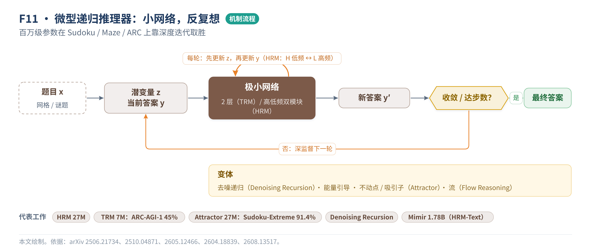

*图 6.11：F11 微型递归推理器——机制图解（本文绘制）*

**代表作**

| 代表作 | 首次公开 | 核心思想 | 关键结果 / 数字 | 粒度 · 循环次数 · 训练方式 | 链接 |
|---|---|---|---|---|---|
| **HRM** | 2025-06-26 | 高频（低层）与低频（高层）两个递归模块分层迭代 | 27M 参数、约 1000 样本，Sudoku/Maze 近满分，ARC 胜过更大模型 | 双模块递归 · 嵌套 · 从头训练 | [arXiv](https://arxiv.org/abs/2506.21734) |
| **HRM: Perspectives & Misconceptions** | 2025-09-30 | 对 HRM 设计与结论的批判性分析 | 澄清 HRM 收益来源 | 分析 | [arXiv](https://arxiv.org/abs/2510.00355) |
| **TRM** | 2025-10-06 | 单个 2 层 7M 网络递归精炼“答案+潜变量”，比 HRM 更简单 | ARC-AGI-1 45%、ARC-AGI-2 8%，参数 <0.01% 于主流 LLM | Model-loop · 深监督多轮 · 从头训练 | [arXiv](https://arxiv.org/abs/2510.04871) |
| **Denoising Recursion Models** | 2026-04-20 | 多步去噪式递归：一步前进 K 步回退 | 在 ARC-AGI 上超过 TRM（据综述） | Model-loop · 多 · 从头训练 | [arXiv](https://arxiv.org/abs/2604.18839) |
| **Mimir** | 2026-08-13 | 基于 HRM-Text 的 1.78B 递归深度语言模型，L/H 双栈交错递归 | sub-2B 模型中 20 个基准平均最高，超过 Ouro 1.4B/2.6B | L/H 双栈 · 交错调度 · 从头训练 | [arXiv](https://arxiv.org/abs/2608.13517) |
| **Classical Energies vs Looped Models 🆕** | 2026-11-12 | 能量下降求解器在 Sudoku/Maze 上比循环模型训练快约 1000× | 对循环推理器的强基线挑战 | — | [arXiv](https://arxiv.org/abs/2611.17309) |

**演进脉络**：HRM（2025.06）→ TRM（2025.10）→ 机制与误解分析（2025.10–2026.01）→ 去噪递归 / 吸引子 / 球面不动点 / 流（2026）→ Mimir（2026.08）→ 能量基线挑战（2026.11）。

**关键结论**

- 结构化推理任务上，“小模型 + 深迭代”可以碾压大模型的“宽而浅”。

**开放问题**

- 这些递归推理器的收益有多少来自循环、多少来自深监督与数据增强？需要更严格的消融。

---

### 6.12 F12 跨模态与应用（Cross-Modal & Applications）

> **定位**：循环深度不只属于语言：视觉、生成、3D、语音、具身、世界模型、推荐、生物都在把“共享块迭代精炼”作为新的扩展轴。  
> **本文收录**：52 篇（主族类）｜ **核心问题**：循环深度在非文本任务上是否同样是有效的扩展轴？

**核心思想**

- **视觉推理**：LoopViT 18M 在 ARC-AGI-1 达 65.8%，超过 73M 集成。
- **具身与世界模型**：RD-VLA 单迭代失败（0%）的任务在 4 次迭代时 >90%，并比 token 推理 VLA 快 80×；Looped World Models 以参数共享块迭代精炼环境潜状态，最高 100× 参数效率；Loop4D 用双流循环扩散 Transformer 做具身 4D 世界模型。
- **生成**：Looped-DiT 260M 超过 6.5× 大模型且推理算力低 4.9×；ELT 参数 4× 减少仍有 FID 2.0；循环扩散 LM（dLoop、ALoDLM、Looped Uniform Diffusion）。
- **3D / 语音 / 推荐 / 科学**：Déjà View 证明循环块是多视图重建更强的归纳偏置；ASR/TTS 的深度条件循环；LoopGR/RecRec 生成式推荐；recAMPLIFY 蛋白、Eco-RNA RNA 基础模型。

**机制图解**

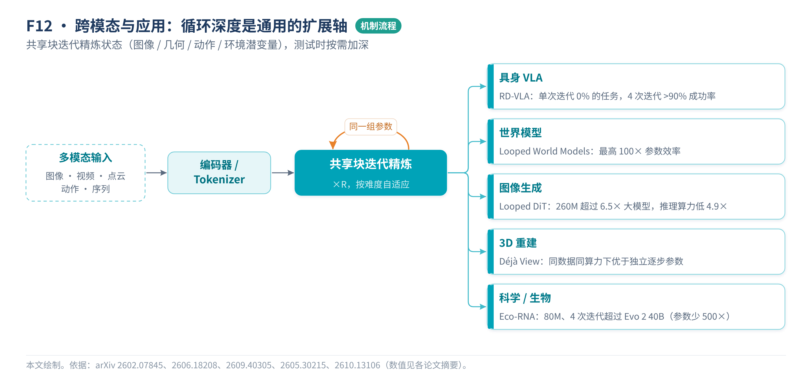

*图 6.12：F12 跨模态与应用——机制图解（本文绘制）*

**代表作**

| 代表作 | 首次公开 | 核心思想 | 关键结果 / 数字 | 粒度 · 循环次数 · 训练方式 | 链接 |
|---|---|---|---|---|---|
| **LoopViT** | 2026-02-02 | 循环 ViT 解视觉 ARC | 18M 模型 ARC-AGI-1 65.8%，超过 73M 集成 | Model-loop · 多 · 从头训练 | [arXiv](https://arxiv.org/abs/2602.02156) · [Code](https://github.com/WenjieShu/LoopViT) |
| **Recurrent-Depth VLA** | 2026-02-08 | VLA 的潜在迭代动作推理，测试时按需增加迭代 | 单迭代 0% 的任务在 4 次迭代时 >90%；较 token 推理 VLA 快 80× | 动作头循环 · 自适应 · 训练 | [arXiv](https://arxiv.org/abs/2602.07845) · [Code](https://rd-vla.github.io/) |
| **ELT（视觉生成）** | 2026-04-10 | 弹性循环 Transformer 做图像/视频生成 | 参数 4× 减少，ImageNet-256 FID 2.0、UCF-101 FVD 72.8 | Block-loop · 弹性 · 训练 | [arXiv](https://arxiv.org/abs/2604.09168) |
| **Déjà View** | 2026-05-28 | 多视图 3D 重建中循环同一块 | 同数据同算力下优于独立逐步参数——循环是更强的归纳偏置 | Block-loop · 16 步 · 训练 | [arXiv](https://arxiv.org/abs/2605.30215) |
| **Looped World Models (LoopWM)** | 2026-06-16 | 首个循环世界模型：参数共享块迭代精炼环境潜状态，自适应深度匹配每步预测复杂度 | 最高 100× 参数效率 | Block-loop · 自适应 · 训练 | [arXiv](https://arxiv.org/abs/2606.18208) |
| **Looped LMs for Tool Calling** | 2026-08-17 | 研究循环 LM 的组合式工具调用 | 多步、依赖感知的工具使用随递归深度提升（据综述） | 训练/评测 | [arXiv](https://arxiv.org/abs/2608.18171) |
| **Looped Diffusion Transformer** | 2026-09-30 | 循环 DiT 做文生图 | 260M 循环模型超过 6.5× 大模型，推理算力低 4.9× | Block-loop · 多 · 训练 | [arXiv](https://arxiv.org/abs/2609.40305) |
| **Eco-RNA** | 2026-10-09 | 可调推理深度的 RNA 基础模型（迭代精炼） | 80M，4 次迭代在 RNAGym 上超过 Evo 2 40B（参数少 500×） | 迭代精炼 · 1–8 · 训练 | [arXiv](https://arxiv.org/abs/2610.13106) |
| **recAMPLIFY** | 2026-10-19 | 递归蛋白质语言模型的大规模预训练 | 155M 唯一参数（少 56%），折叠准确率 +22.5% | Block-loop · 从头训练 | [arXiv](https://arxiv.org/abs/2610.26747) · [Code](https://github.com/chandar-lab/AMPLIFY/tree/recamplify) |
| **LoopMR 🆕** | 2026-11-11 | 单个共享块实现加速 MRI 重建 | — | — | [arXiv](https://arxiv.org/abs/2611.14947) · [Code](https://github.com/hym97/LoopMR) |
| **Reusing Layers for Multimodal Embeddings 🆕** | 2026-11-15 | 何时重复运行同一层能提升多模态嵌入 | — | — | [arXiv](https://arxiv.org/abs/2611.19827) |
| **Depth-Linked Residual Tokens 🆕** | 2026-11-19 | 把循环迭代与可并行的寄存器 token 结合，用于多模态检索与生成 | — | — | [arXiv](https://arxiv.org/abs/2611.26752) |
| **dLoop 🆕** | 2026-11-19 | 循环扩散语言模型：在提交前循环精炼潜表示 | 减少去噪步数 | — | [arXiv](https://arxiv.org/abs/2611.26275) |
| **DyLoMo-DiT 🆕** | 2026-11-23 | 动态循环 MoE 扩散 Transformer | — | — | [arXiv](https://arxiv.org/abs/2611.30844) |
| **LoopFit 🆕** | 2026-11-24 | 把预训练 DiT 改造为带递归精炼的循环模型 | 扩散 Transformer 的循环改造 | — | [arXiv](https://arxiv.org/abs/2611.32175) |
| **LoopDVR 🆕** | 2026-11-24 | 循环 Transformer 用于高效稠密视觉识别 | — | — | [arXiv](https://arxiv.org/abs/2611.32067) · [Code](https://github.com/Intellindust-AI-Lab/LoopDVR) |
| **Distill to Loop 🆕** | 2026-11-24 | 把预训练 DiT 蒸馏为深度可调的循环模型 | — | — | [arXiv](https://arxiv.org/abs/2611.31977) |
| **Loop4D 🆕** | 2026-11-25 | 4D VAE + 双流循环扩散 Transformer 的具身世界模型 | 共享权重循环提升 RGB-几何联合预测 | — | [arXiv](https://arxiv.org/abs/2611.34199) |
| **Where to Approximate (Déjà View 加速) 🆕** | 2026-11-25 | 分析循环多视图重建中近似误差的传播并据此加速 | 较官方 16 步 Déjà View 快 1.63× | — | [arXiv](https://arxiv.org/abs/2611.33948) |

**演进脉络**：Block-recurrent ViT 动力学（2025）→ LoopViT、RD-VLA、Recursive LMM（2026.02）→ ELT、Déjà View（2026.04–05）→ Looped World Models（2026.06）→ Looped-DiT、LoopVL、Eco-RNA、recAMPLIFY（2026.09–10）→ Loop4D、dLoop、LoopDVR、LoopMR（2026.11）。

**关键结论**

- 凡是需要“维持中间状态并逐步修正”的任务（动作规划、几何求解、去噪、长程模拟），循环都是天然的归纳偏置。

**开放问题**

- 跨模态统一的循环骨干（如 SenseNova-Loop 的图文多模态）在视频/动作上的扩展仍待验证。

---

### 6.13 F13 综述与相关潜在推理（Surveys & Related Latent Reasoning）

> **定位**：循环深度之外，在潜空间增加计算的相邻路线——理解它们有助于判断循环的独特价值与互补关系。  
> **本文收录**：16 篇（主族类）｜ **核心问题**：循环深度之外，还有哪些“潜在计算”扩展轴？

**核心思想**

- **连续潜空间推理**：Coconut 把最后隐状态当作“连续思维”回填；与循环深度同属潜在推理，但计算沿序列方向展开。
- **额外计算 token**：Pause tokens 用无意义 token 换取计算。
- **动态深度**：Mixture-of-Depths 按 token 路由跳层，与 MoR 互为镜像。
- **序列长度扩展**：Hidden Decoding 在 WeLM-HD4-617B 上沿序列方向扩展潜在计算，并声称更兼容流水线并行——与 Loopie 的层级循环形成对照。

**机制图解**

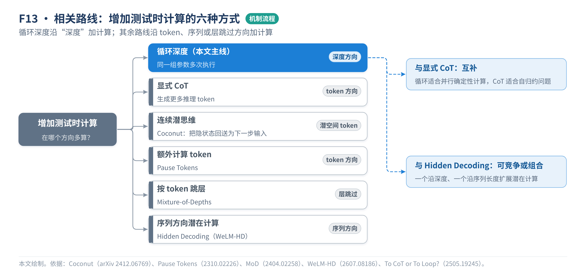

*图 6.13：F13 综述与相关潜在推理——机制图解（本文绘制）*

**代表作**

| 代表作 | 首次公开 | 核心思想 | 关键结果 / 数字 | 粒度 · 循环次数 · 训练方式 | 链接 |
|---|---|---|---|---|---|
| **Pause Tokens** | 2023-10-03 | 插入暂停 token 换取额外计算 | 序列维度的额外计算 | 训练 | [arXiv](https://arxiv.org/abs/2310.02226) |
| **Mixture-of-Depths** | 2024-04-02 | 按 token 路由跳过层 | 动态分配深度计算的相关路线 | 训练 | [arXiv](https://arxiv.org/abs/2404.02258) |
| **Coconut** | 2024-12-09 | 把最后隐状态作为“连续思维”回填为下一步输入，在潜空间推理 | 连续潜空间 CoT 的代表 | 潜在条件 · 训练 | [arXiv](https://arxiv.org/abs/2412.06769) |
| **A Survey on Latent Reasoning** | 2025-07-08 | 潜在推理综述，覆盖垂直递归（循环/UT）与水平递归等 | 领域综述 | 综述 | [arXiv](https://arxiv.org/abs/2507.06203) · [Code](https://github.com/multimodal-art-projection/LatentCoT-Horizon/) |
| **Hidden Decoding (WeLM-HD) WeChat（据综述）** | 2026-07-09 | 沿序列长度方向扩展潜在计算（对照路线） | WeLM-HD4-617B：首个 100B+ MoE 规模的序列长度扩展 | n=4 · 从头训练 | [arXiv](https://arxiv.org/abs/2607.08186) |
| **Dual-Loop Transformers (Markovian) 🆕** | 2026-11-20 | 面向一阶马尔可夫推理的结构化缓存压缩与双循环 Transformer | — | — | [arXiv](https://arxiv.org/abs/2611.28285) |

**演进脉络**：Pause Tokens（2023）→ MoD（2024.04）→ Coconut、CCoT（2024.12）→ 潜在推理综述（2025.07）→ Hidden Decoding（2026.07）→ 潜在推理统一分类、鲁棒性评估（2026）。

**关键结论**

- 循环深度与序列方向潜在计算在 100B+ 规模上尚无正面对比。

**开放问题**

- 是否存在统一“深度 × 序列 × token”三维计算分配的框架？

---

## 7. 开源模型与工业实践

### 7.1 开源 / 公开模型总表

| 模型 | 机构 / 作者 | 发布 | 参数 | 训练 tokens | 循环方式（粒度） | 循环次数 | 关键特点 | 代表结果 | 开放情况 | 链接 |
|---|---|---|---|---|---|---|---|---|---|---|
| **Huginn-0125** | Geiping 等（ELLIS / UMD / LLNL） | 2025-02 | 3.5B 稠密 | 0.8T | Block-loop：Prelude–Core(4层)–Coda | 训练随机 r̄=32，测试自由（可到 64） | 首个现代规模循环深度 LM；截断反传；三段式；vLLM 插件 | 计算量等价约 50B 参数；r 4→32 ARC-E 49.1→69.9 | 权重+代码+数据开源 | [huggingface.co](https://huggingface.co/tomg-group-umd/huginn-0125) · [github.com](https://github.com/seal-rg/recurrent-pretraining) |
| **Ouro-1.4B / 2.6B（含 Thinking）** | ByteDance | 2025-10 | 1.4B / 2.6B | 7.7T | Model-loop：整栈共享 R=4 + 退出门 | 4（可早停） | 熵正则深度分配；每步 LM 损失；vLLM v0.11.1–v0.26.0 原生支持（2026-07 移出主线） | 1.4B/2.6B 匹配至多 12B 的 SOTA 模型；2–3× 参数效率 | 权重开源（Apache-2.0） | [huggingface.co](https://huggingface.co/ByteDance/Ouro-1.4B) · [huggingface.co](https://huggingface.co/ByteDance/Ouro-2.6B-Thinking) · [ouro-llm.github.io](https://ouro-llm.github.io/) |
| **LoopCoder-V2** | 北航 / IQuest（HF: Multilingual-Multimodal-NLP） | 2026-06 | 7B 稠密（14 个共享层） | 18T | Model-loop：Parallel Loop Transformer（跨循环位置偏移 + 共享 KV 门控滑窗） | 2 | 代码/Agent 专用；指令微调 | SWE-bench Verified 43.0→64.4；Multi-SWE 14.0→31.0 | 权重开源（Apache-2.0） | [huggingface.co](https://huggingface.co/Multilingual-Multimodal-NLP/LoopCoder-V2) |
| **Loopie-20B-A2B / 6B-A0.6B** | IQuest | 2026-07 | 20B-A2B / 6B-A0.6B MoE | 3.5T | Layer-loop：每层重复后再进入下一层 | 2 | 实测 step 时间匹配；SPT 后训练；megatron-loopie / vllm-loopie 分支 | 同算力超过 vanilla 30B-A3B 基线 | 据论文开源 | [arxiv.org](https://arxiv.org/abs/2607.16051) |
| **Nanbeige4.2-3B** | Nanbeige Lab | 2026-07 | 3B（非嵌入） | 28T | 层栈复用（Looped Transformer） | 2 | 面向 Agent 的紧凑模型；SFT 环境合成 + 结果/过程奖励 RL | Agent 基准超过 Qwen3.5-9B、Gemma4-12B | 权重开源（Apache-2.0） | [huggingface.co](https://huggingface.co/Nanbeige/Nanbeige4.2-3B) |
| **Mimir v1 / v1.5** | Schneider-Kamp 等 | 2026-08 | 1.78B（HRM-Text） | 每 epoch 70.5B / 103B（多 epoch） | L/H 双栈交错递归 | 交错调度 | 仅用合规许可数据训练 | sub-2B 模型 20 基准平均最高，超过 Ouro 1.4B/2.6B | 见论文 | [arxiv.org](https://arxiv.org/abs/2608.13517) |
| **Koi-4B（Elastic Latent Recurrence）** | Ladhak 等 | 2026-10 | 4B | — | Block-loop 弹性潜在递归 | 1–4（单一 checkpoint） | MoE 版复用首轮专家路由 | 1 循环≈Qwen3.5-4B（AAII 18），4 循环 AAII 29 | 开放情况未核实 | [arxiv.org](https://arxiv.org/abs/2610.12582) |
| **Metis-1.6 Praxis / Logos** | Lernex（单人研究者） | 2026-10 | 2.94B-A0.46B / 10.23B-A1.18B 混合 Mamba-2/注意力 MoE | 1.02T | 整栈循环 | 2 | 每 token 让整栈“再看一遍” | — | HF 组织 Lernex（抓取时仅见 Metis-1.3 模型） | [huggingface.co](https://huggingface.co/Lernex) · [arxiv.org](https://arxiv.org/abs/2610.37903) |
| **SenseNova-Loop-9B-Preview** | SenseNova（OpenSenseNova） | 2026-10-31 | ≈9B | — | 同正式版 | 2 | 首个预览版 | — | 权重+代码开源 | [huggingface.co](https://huggingface.co/sensenova/SenseNova-Loop-9B-Preview) · [github.com](https://github.com/OpenSenseNova/SenseNova-Loop) |
| **Dory1.0-4B** | Fishman 等 | 2026-11-02 | 4B nGPT | 6T（前 4.5T NVFP4） | Block-loop：input / shared recurrent / output | 弹性（≥2 收益明显） | 滑窗+全注意力交错；256K 上下文；难度感知循环课程 RLVR；仅缓存末轮 KV | ≥2 循环 12 基准平均超过 Qwen3.5-9B、Gemma 4 12B、Gemma 4 26B-A4B | BF16 / MXFP8 / NVFP4 / GGUF 开源（据论文） | [arxiv.org](https://arxiv.org/abs/2611.03998) |
| **ARLoop 0.6B / 1.2B** | Yao 等 | 2026-11-03 | 0.6B / 1.2B | 0.5T（1.2B） | 深度方向注意力残差 | 3 | 完全开源的循环预训练 | 1.2B 全面超过 Huginn-3.5B，接近 Qwen3.5-2B | 完全开源（据论文） | [arxiv.org](https://arxiv.org/abs/2611.05234) |
| **SenseNova-Loop-9B** | SenseNova（OpenSenseNova） | 2026-11-17 | ≈9B（≈14.6B 推理等效） | — | 中段 Block-loop：层 [4,28) 循环 2 次（32 层→56 次执行）+ 双流 mHC + 3:1 线性/全注意力 | 2（3–4 仍有增益） | 多模态（文本+图像）、512K 上下文；AWQ/GGUF；SGLang/vLLM PR 支持 | AutomationBench 36.67（=Qwen3.8-27B）；AIDABench 65.31 vs 65.01；Terminal-Bench 2.1 59.55 | 权重+代码开源（Apache-2.0） | [huggingface.co](https://huggingface.co/sensenova/SenseNova-Loop-9B) · [github.com](https://github.com/OpenSenseNova/SenseNova-Loop) |
| **GLM-5.4** | Z.ai | 2026-11-23 | 750B 级（GLM-5 基座） | —（继续训练改造） | 中段 Block-loop：28 层循环 2 次；逐 token 门控渐进更新；全局共享+独立滑窗混合 KV；稀疏注意力索引复用 | 2 | 由预训练基座继续训练改造为 Loop；1B/4B/30B/750B 逐级验证 | 30B 等参对照（多约 10% 训练算力）显著提升；输出长度降 10–14%；称智能水平可比 2T–3T 参数模型 | 权重计划在安全加固后开放 | [z.ai](https://z.ai/blog/glm-5.4) |
| **LoopTitan** | Tian 等 | 2026-11-25 | MoE | — | 参数重访（parameter revisit） | — | Phase-1 技术报告 | — | 代码+模型（HF NaturalScale，据 arXiv 备注） | [github.com](https://github.com/datamllab/LoopTitan) · [huggingface.co](https://huggingface.co/NaturalScale) |
| **Inkling-2-Mini** | （见 2611.29092 所研究模型） | 2026-11 | 26.4B 循环 MoE | — | 48 次逻辑访问，40 次滑窗访问 | — | 原生 1M 上下文 | 2-bit SRFT KV 后在 32GB Apple 设备上跑 1M 上下文 | 开放情况未核实 | [arxiv.org](https://arxiv.org/abs/2611.29092) |
| **TRM（Tiny Recursive Model）** | Jolicoeur-Martineau | 2025-10 | 7M（2 层） | ~1000 样本/任务 | Model-loop 深监督递归 | 多轮 | 非语言建模：结构化谜题 | ARC-AGI-1 45%，ARC-AGI-2 8% | 代码开源（见论文） | [arxiv.org](https://arxiv.org/abs/2510.04871) |
| **HRM（Hierarchical Reasoning Model）** | Wang 等 | 2025-06 | 27M | ~1000 样本/任务 | 高/低频双模块递归 | 嵌套 | 非语言建模：Sudoku/Maze/ARC | Sudoku/Maze 近满分 | 代码开源（见论文） | [arxiv.org](https://arxiv.org/abs/2506.21734) |

> 注：“开放情况”以抓取到的模型卡/仓库/论文自述为准；Koi-4B、Inkling-2-Mini 的权重可得性本次未能核实。GLM-5.4 官方表示将在安全加固后开放权重。

### 7.2 工业落地：四种典型路线

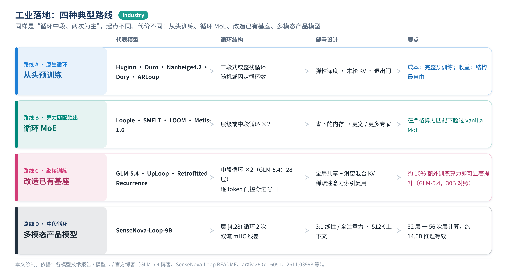

*图 7-1：工业落地的四种典型路线——起点不同、代价不同，但都收敛到“循环中段、两次为主”（本文绘制）*

### 7.3 重点解读

**GLM-5.4（Z.ai，2026-11-23）——首个 750B 级旗舰 Loop 模型**
- **路线**：不从头训练，而是把已预训练的 GLM-5 基座通过继续训练改造为 Loop Transformer：循环 **28 层 × 2 次**；官方称智能水平可比 2T–3T 参数模型。
- **三项结构改动**：① **门控渐进更新**——每轮每 token 独立门控，把候选更新按比例写回残差流，第一轮保守写入、第二轮放开，且难 token 第一轮写得更激进；② **混合 KV 缓存**——第二轮复用第一轮选出的稀疏 KV，并保留本轮滑窗内的新 KV，额外一轮只多一个滑窗的 KV 成本，1M 上下文下部署成本可控；③ **稀疏注意力索引复用**——第二轮直接复用第一轮 indexer 的索引，零额外索引开销。
- **验证**：在 1B / 4B / 30B / 750B 逐级验证；30B 等参数对照仅多约 10% 训练算力即在数学、科学推理、长上下文上显著提升，且 GPQA-Diamond、MMLU-Pro 等平均输出长度下降 10–14%——部分推理从显式 token 转移到循环的隐式深度。
- **已知局限**：易陷入过长的“马拉松式思考”；后续将探索自适应计算（难 token 更多迭代）。

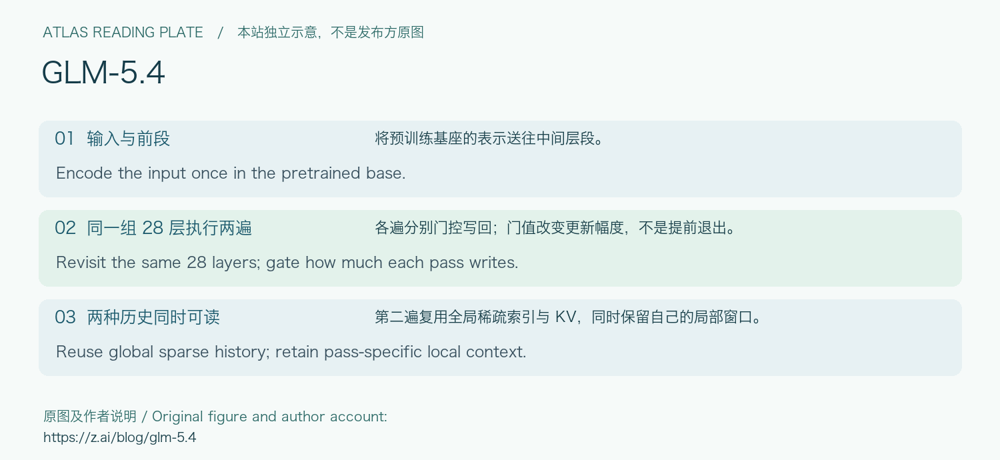

*图 7-2：GLM-5.4 整体架构——Prelude（L1–26）→ Loop Pass 1（L27–54，28 层）→ Loop Pass 2（复用 L27–54 权重；两库稀疏 MLA 同时读取首轮稀疏前缀 KV 与第二轮 128-token 滑窗 KV）→ Coda（L55–78）→ LM Head；每轮出口由 Damp Gate 按 x₁ = x₀ + β₁(h₁ − x₀) 渐进写回（Reference：Z.ai 技术博客 [GLM-5.4: Toward Generalized Coding with Our First Loop Transformer](https://z.ai/blog/glm-5.4)，2026-11-23，博客架构图）*

**SenseNova-Loop-9B（2026-10-31 Preview / 2026-11-17 正式版）**
- 32 层多模态解码器中层 [4,28) 共 24 层循环两次 → 每次前向 56 次层计算、约 14.6B 推理等效参数；循环块内采用**双流 mHC**（Sinkhorn 20 次约束流间混合）；3:1 线性/全注意力混合；512K 上下文；4-bit 权重 + 8-bit KV 下 256K 多模态推理约 15 GiB 显存。
- Loop 扩展实验（Loop 1→4）：各任务在 3–4 次循环达到最佳，默认 2 次兼顾效率；2→4 次 LiveCodeBench V6 +1.04pp。

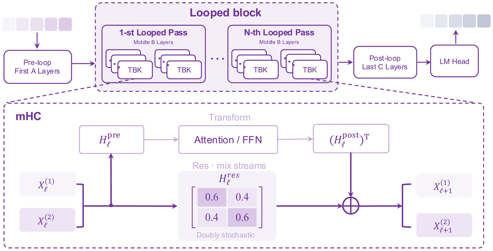

*图 7-3：SenseNova-Loop-9B 整体架构（前置 A 层 → 循环块（多轮 Looped Pass）→ 后置 C 层 → LM Head；下方为 mHC 模块）（Reference：[OpenSenseNova/SenseNova-Loop](https://github.com/OpenSenseNova/SenseNova-Loop) README 原图 `assets/hero.png`）*

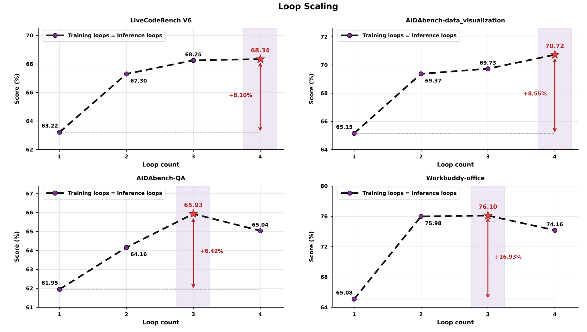

*图 7-4：SenseNova-Loop 的循环次数扩展实验（Reference：[OpenSenseNova/SenseNova-Loop](https://github.com/OpenSenseNova/SenseNova-Loop) README 原图 `assets/loop_scaling_zh_latest.png`）*

**Dory1.0-4B（2026-11-02）**：nGPT 骨干 + 滑窗/全注意力交错，input–shared recurrent–output 三段式；6T tokens（前 4.5T 以 NVFP4 训练）、256K 上下文；SFT + RLVR 时用**难度感知循环课程**把难题路由到更深循环；≥2 次循环时 12 项基准平均超过 Qwen3.5-9B、Gemma 4 12B 与 Gemma 4 26B-A4B；4 次循环时 Agent 任务输出 token 少 1.3–2.5×；只缓存最后一轮 KV，使任意循环数下 KV 与非循环模型相同。

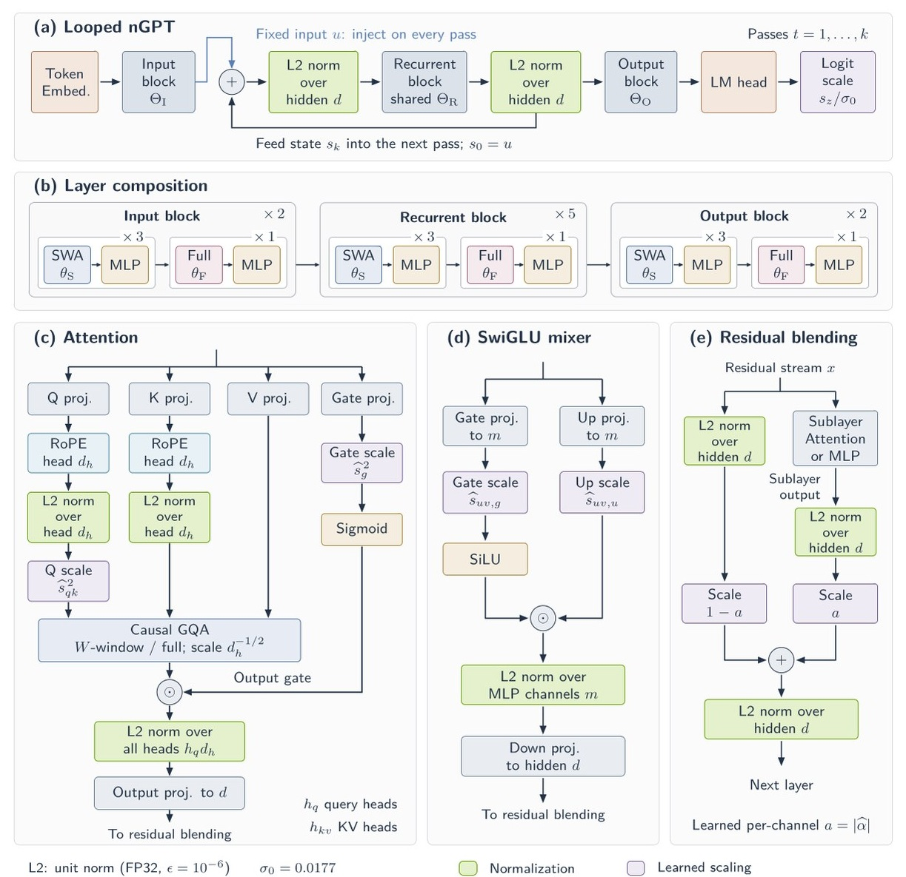

*图 7-5：Dory1.0-4B 的循环 nGPT 架构——(a) 16 层输入块产生固定表示 u，40 层循环块共享全部权重、最多循环 4 次，每轮把 u 加到状态上（s₀ = u）并在前后做 L2 归一化，16 层输出块后接 LM Head；(b) 每 8 层为 3 组 SWA + 1 组全注意力（3:1）；(c)–(e) 注意力、SwiGLU 与残差混合细节（Reference：Fishman et al., [Dory1.0-4B: A Looped Normalized-GPT](https://arxiv.org/abs/2611.03998), arXiv 2611.03998, Figure 2）*

**Ouro（ByteDance，2025-10）**：1.4B/2.6B、7.7T tokens、R=4 + 退出门；匹配至多 12B 的 SOTA 模型；是 2026 年大量后续研究（RLTT、LLA、LoopVQ、安全跨深度等）的公共实验底座——项目页称已有 158 篇论文引用、15 篇直接基于其 checkpoint。vLLM v0.11.1 起原生支持，v0.26.0 后移除。

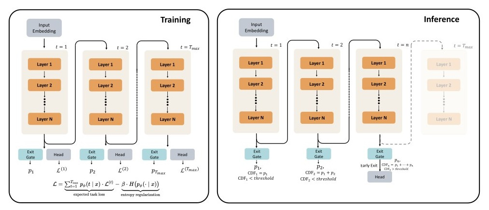

*图 7-6：Ouro（LoopLM）架构——左（训练）：同一个 N 层栈重复 T_max 步，每步都有 LM Head 损失 𝓛⁽ᵗ⁾ 与退出门概率 p_t，总损失 = 按退出分布加权的任务损失 − β·熵正则；右（推理）：累计退出概率（CDF）超过阈值即提前退出（Reference：Zhu et al., [Scaling Latent Reasoning via Looped Language Models](https://arxiv.org/abs/2510.25741), arXiv 2510.25741, Figure 3）*

**MoLT（HUST / ByteDance Seed / U Toronto，2026-11-25）**：提出“循环之间应该传递什么”——用 KV 作为跨循环记忆（MoLA）；U-MoLT 把记忆构建（循环编码器）与预测读出（只交叉注意的解码器）分离，配合 MoL-Hybrid 解码使延迟与非循环 OLMo3 持平（996.6 vs 1000.6 ms），400B tokens 下 700M 取得 1.7× 验证交叉熵 token 效率。

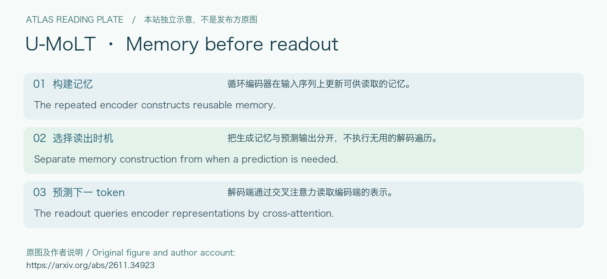

*图 7-7：U-MoLT 架构（循环编码器构建 KV 记忆 + 交叉注意解码器读出）（Reference：[hustvl/MoLT](https://github.com/hustvl/MoLT) README 原图 `assets/molt_architecture.png`；MoLT, arXiv 2611.34923）*

### 7.4 技术博客与报道

| 日期 | 标题 | 来源 | 要点 |
|---|---|---|---|
| 2026-11-23 | [GLM-5.4: Toward Generalized Coding with Our First Loop Transformer](https://z.ai/blog/glm-5.4) | Z.ai 博客 | 750B 规模首个旗舰 Loop 模型；28 层×2；门控渐进更新、混合 KV、稀疏索引复用；推理 70–200 tok/s |
| 2026-11-17 | [SenseNova-Loop-9B 正式版（GitHub README）](https://github.com/OpenSenseNova/SenseNova-Loop) | GitHub | 32 层→56 次执行；双流 mHC；多模态 512K；Loop 1–4 扩展实验 |
| 2026-10-31 | [SenseNova-Loop-9B-Preview](https://huggingface.co/sensenova/SenseNova-Loop-9B-Preview) | GitHub / HF | 预览版发布 |
| 2026-09-30 | [Training a Looped Transformer: When to Repeat, Review, and Stop](https://huggingface.co/blog/TiGa-RCE/training-looped-transformers) | Hugging Face 社区博客（TiGa-RCE） | 小规模 PyTorch 实验：更多循环不一定更经济；按“块调用次数”计算成本；复习/遗忘与基于 margin 的复习策略 |
| 2026-11-06 | [Awesome Loop Transformer（GitHub 清单 + 在线文库 + 综述）](https://github.com/asimfish/awesome_loop_transformer) | GitHub / GitHub Pages | 333 篇条目、5 篇核心精读、十条趋势洞察、模型目录 |
| 2026-10 | [Ouro 项目页（含 vLLM 支持状态与 35 个后续工作）](https://ouro-llm.github.io/) | 项目主页 | vLLM v0.11.1 起原生支持，v0.26.0 后移除；158 篇论文引用 |
| 2026-09-02 | [GPT-6 Astra 被报道使用 recurrent depth（据 awesome 综述转述 The Information）](https://github.com/asimfish/awesome_loop_transformer) | 二手报道 | 架构细节未公开，仅作背景，不作为证据 |

> Hugging Face 社区博客（TiGa-RCE, 2026-09-30）的提醒值得工程团队记住：**计算成本应按“块调用次数 = 循环数 × 优化步数”记账**；在其小规模任务中，相同块调用预算下 1 次循环反而最经济，推理时加深也并非单调有益——“额外的循环需要单独评估”。

---

## 8. 十大趋势判断（含 2026-11 最新变化）

> 前 10 条在 awesome_loop_transformer 综述（2026-09-06 首版、11-06 更新）十条洞察基础上，结合本文新增的 2026-11-06 至 11-26 论文与工业发布重新整理；🆕 标注为本次新增证据。

| # | 趋势 | 关键证据 | 状态（2026-11-26） |
|---|---|---|---|
| 1 | **循环通过了算力匹配这道门，但门很窄** | Loopie（实测 step 时间匹配）、SMELT（FLOPs/参数/KV 同时匹配，省 6.8–18%）；Loopback、Truncate-or-Not 在稠密从头训练也胜出；🆕 2611.34276 在 69B/51B MoE 上 +1.16/+2.29pp；🆕 MoLT 在 400B tokens 胜 OLMo3 | 强化：胜出配置从“MoE+层循环+2 次”扩展到稠密与 KV 记忆设计 |
| 2 | **“循环几次”分两种体制** | 固定预训练预算→2；可变推理算力→自适应且可深（Huginn 32–64）；LOOM 5–12、UpLoop R=3 | 修正：2 次是当前设计的最优，不是规律 |
| 3 | **粒度越来越细，并收敛到中段** | 深度分数≈0.5（Training-Free）、SMELT 中间一半、Huginn 三段式；🆕 SenseNova [4,28)、GLM-5.4 28 层、2611.34276 Core 占 25–35% | 强化：工业模型全部循环中段 |
| 4 | **ODE 流 vs 不动点：两种哲学分化** | Training-Free（预训练中段非收缩，阻尼欧拉）vs STARS / FPR / Attractor；🆕 Halpern 迭代解释、Rectified Looped Transformer 插值反馈、FlyingStart 不动点暖启动 | 持续：改造用 ODE/门控，原生训练用不动点 |
| 5 | **训练稳定性从经验变成定理** | Loop-μP（1/N）、DeepLoop（1/2）、Fully Looped 12 轮、LoopMTP 15 轮；🆕 循环数调度研究、Sparrow 优化器 | 基本解决 |
| 6 | **推理成本是最后的大瓶颈，已拆成三个子问题** | 延迟（PLT、扩散采样 5×、自投机 7.5×）、KV（LLA 32×、末轮 KV、混合 KV）、量化（LoopQ、LoopVQ）；🆕 11 月一个月内出现 10+ 篇投机解码/KV 工作 | 快速推进：服务化成为最大论文簇 |
| 7 | **潜在循环与显式 CoT 互补；RL 需重设计** | LoopCoder-v2 超加性、LOTUS 追平 CoT、RLTT/LoopRPT；🆕 ELGO、末轮外推自蒸馏、深度偏好内化 | 扩展：后训练需覆盖每个深度 |
| 8 | **循环操纵知识而不存储知识** | Ouro 归因、Frey 等“多想 vs 多记”、Dual-Path 分流；循环超过训练视界会损害知识；🆕 2611.28808 知识可读时序 | 支持：记忆/状态通道进入架构 |
| 9 | **应用从谜题扩展到 Agent、具身与科学** | SWE-bench +21.4、工具调用、RD-VLA、世界模型、Looped-DiT、Eco-RNA；🆕 Loop4D、dLoop、LoopMR | 扩展 |
| 10 | **产品化开始，工具链在追赶** | Nanbeige4.2、Dory、SenseNova-Loop（SGLang/vLLM PR、AWQ/GGUF）、GLM-5.4（与推理基础设施协同设计、融合 kernel，70–200 tok/s） | 修正：工具链已部分跟上，但接口未标准化 |

**🆕 第 11 条（新增）——循环深度成为安全与对齐的新维度**：半深度运行时拒答行为可能失效、越狱成功率随深度变化；后训练与安全评测都需要扫描深度。

**🆕 第 12 条（新增）——“循环之间传递什么”成为 2026 年末的结构主题**：残差（Loopback）、注意力残差（ARLoop、LoopRes）、多流超连接（Hyperloop、SenseNova mHC）、KV 记忆（MoLT）、潜在递归记忆（LRT）、跨轨迹注入（InfuseLoop）——从“重复同一个函数”走向“设计循环间的信息通道”。

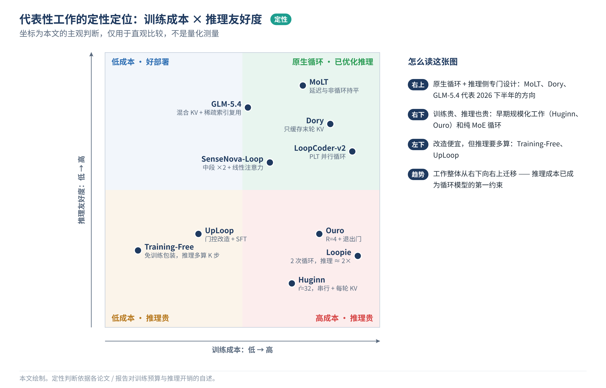

*图 8-1：代表性工作的定性定位（坐标为本文主观判断，仅用于直观比较，非量化测量）*

---

## 9. 开放问题与研究机会

1. **算力匹配下的多循环（R≥4）**：所有前沿规模的算力匹配胜出都在 R=2；LOOM 的 5 次最优只在 700M 规模。
2. **完整推理账单**：训练 step 时间、推理延迟、峰值 KV 应同时报告；“训练算力匹配”不等于“推理成本匹配”。
3. **100B+ 扩展律**：φ=0.46 的等深度律与 SMELT/循环 MoE 律在 100B+ 规模是否成立？
4. **预训练规模的自适应停机**：MoR、TaH、RecurTrace 多在 ≤8B；批量服务下停机收益需重新度量。
5. **潜在推理的可监督性与安全**：无 CoT 数据时如何让循环轨迹可读、可审计？如何保证每个深度都对齐？
6. **层级循环的机制**：为何 layer-loop 在 MoE 上有效？“第二次访问降低 attention sink”（SMELT）是目前唯一的机制解释。
7. **循环 vs 序列长度扩展**：Hidden Decoding（WeLM 617B）与层级循环在 100B+ 规模尚无正面对比。
8. **改造的边界**：No Free Loop（事后循环仅 0.8B 胜出）与 GLM-5.4（750B 改造显著受益）结论方向不同——差异来自继续训练量、门控设计还是评测口径？
9. **标准化工具链**：KV 布局、循环数配置、早停 API、量化格式在 vLLM / SGLang / llama.cpp 间尚未统一。

---

## 10. 工程选型：决策流程与实践清单

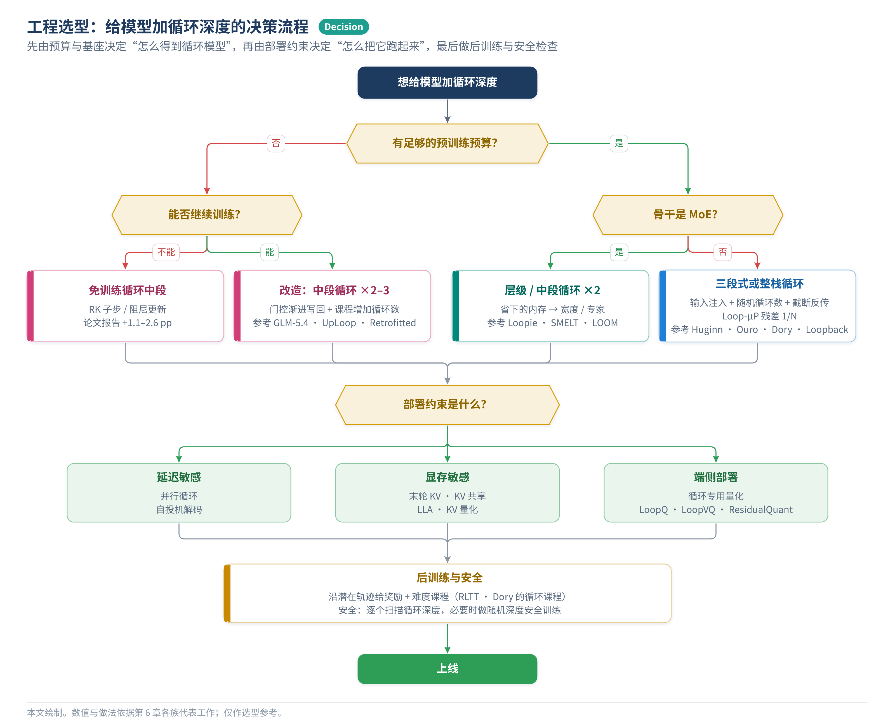

*图 10-1：工程选型决策流程——先决定怎么得到循环模型，再决定怎么部署，最后做后训练与安全检查（本文绘制）*

**实践清单**
- 循环**中段**（深度分数约 0.4–0.7），首尾层保持独立；MoE 用**层级循环**。
- 任何“让某段层多跑一遍”的实验都用**阻尼/门控更新**：$x \leftarrow (1-\tfrac1K)x + \tfrac1K g(x)$ 或逐 token 门控写回。
- 原生训练：输入注入 + 训练时随机循环数 + 截断反传；残差按 1/N 缩放；学习率可跨循环数迁移。
- 先评估 **R=2**，再在推理侧用自适应/弹性深度探索更深；循环数增加要单独评测，不保证单调变好。
- 部署前实测**延迟、峰值 KV、吞吐**；优先考虑末轮 KV 缓存或 KV 共享 + 滑窗。
- 循环模型最适合与**检索、长上下文、MoE 专家库**搭配；把知识存储交给它们。
- 后训练不要直接复用 CoT 时代的 GRPO；安全评测覆盖所有可运行深度。

---

## 11. 资料来源、图片引用与遍历说明

### 11.1 遍历与检索说明

| 来源 | 处理方式 | 结果 |
|---|---|---|
|  |  |  |
| 清单内代码 / 模型链接 | 逐个访问（GitHub / HF / 项目页） | 53 个链接，30 个可读取，其余被站点内容过滤或无文本返回（见 Excel `Link_Audit`） |
| 清单配套材料 | 读取 README、guide.md、models.md、survey_en.md、在线文库、slides、figures 目录 | 用于分类、时间线、趋势与图片引用 |
| arXiv 增量检索（2026-11-06 → 11-26） | arXiv 检索（标题/摘要含 looped transformer、recurrent depth、looped language model 等，cs 类） | 新增 43 篇（已人工筛除无关“closed-loop”类论文） |
| 用户指定参考 | GLM-5.4 博客、Dory 论文、HF 博客（TiGa-RCE）、SenseNova-Loop 仓库、Looped World Models、Training-Free Looped | 全部读取并纳入正文/表格 |
| 模型卡与项目页 | Huginn、Ouro、LoopCoder-V2、Nanbeige4.2、Lernex、SenseNova、MoLT 等 | 用于开源模型表 |

> 局限：部分 GitHub 仓库页面被抓取服务的内容过滤拦截，未能读取 README 细节（这些仓库仍以链接形式保留在 Excel 中）；awesome 综述中关于 GPT-6 Astra 的内容为二手报道，本文仅作背景。

### 11.2 图片引用

所有图片都已保存在本文档旁的 `images/` 文件夹中，正文用相对路径引用：`images/external/` 为原样保存的论文 / 仓库 / 博客图片，`images/redrawn/` 为本文重新绘制的概念示意图，`images/illustrated/` 为本图解版的全部结构图（均同时提供 PNG 与可编辑的 SVG）。

| 图 | 内容 | 本地文件 | Reference |
|---|---|---|---|
| 图 1-1 | 共享块反复更新隐状态 | `images/redrawn/fig01_recurrent_depth_overview.png` | 本文重新绘制；概念参考 awesome_loop_transformer 同主题示意图；公式据 Huginn（arXiv 2502.05171） |
| 图 1-2 | 循环粒度地图（粒度 × 调度） | `images/redrawn/fig02_loop_granularity.png` | 本文重新绘制；概念参考 awesome_loop_transformer；PLT 调度据 arXiv 2510.24824 |
| 图 6.1b | Universal Transformer + ACT | `images/redrawn/fig03_ut_act.png` | 本文重新绘制；依据 arXiv 1807.03819、1603.08983 |
| 图 6.3b | Huginn 三段式结构 | `images/redrawn/fig04_huginn_prelude_core_coda.png` | 本文重新绘制；依据 arXiv 2502.05171 |
| 图 6.4b | 循环 MoE 的匹配预算比较 | `images/redrawn/fig05_looped_moe_matched_budget.png` | 本文重新绘制；依据 arXiv 2607.16051、2609.01343、2610.37903 |
| 图 6.5b | 免训练循环的 ODE 视角 | `images/redrawn/fig06_training_free_ode.png` | 本文重新绘制；依据 arXiv 2605.23872 |
| 图 6.8b | PLT 调度与 LoopCoder-v2 收益–成本 | `images/redrawn/fig07_plt_gain_cost.png` | 本文重新绘制；依据 arXiv 2510.24824、2606.18023 |
| 图 6.3（附） | MoLT 跨循环 KV 可见性 | `images/external/molt_attention_visibility.png` | [hustvl/MoLT](https://github.com/hustvl/MoLT) README 原图 |
| 图 7-2 | GLM-5.4 整体架构 | `images/external/glm54_architecture.png` | [Z.ai 技术博客](https://z.ai/blog/glm-5.4) 架构图（宽 1800 px 副本） |
| 图 7-3 | SenseNova-Loop-9B 架构 | `images/external/sensenova_loop_architecture.jpg` | [OpenSenseNova/SenseNova-Loop](https://github.com/OpenSenseNova/SenseNova-Loop) README 原图（宽 1600 px 副本） |
| 图 7-4 | SenseNova-Loop 循环次数扩展 | `images/external/sensenova_loop_scaling_zh.png` | 同上仓库 README 原图（宽 1600 px 副本） |
| 图 7-5 | Dory1.0-4B 循环 nGPT 架构 | `images/external/dory_architecture.jpg` | arXiv 2611.03998 Figure 2（从论文 PDF 第 3 页截取） |
| 图 7-6 | Ouro（LoopLM）训练 / 推理架构 | `images/external/ouro_looplm_architecture.jpg` | arXiv 2510.25741 Figure 3（从论文 PDF 第 4 页截取） |
| 图 7-7 | U-MoLT 架构 | `images/external/molt_architecture.png` | [hustvl/MoLT](https://github.com/hustvl/MoLT) README 原图 |
| 图 1-3 | 五种循环结构 | `images/illustrated/g1_loop_structures.png` | 本文绘制（依据正文所引论文与资料；SVG 可编辑版同名） |
| 图 2-1 | 发展时间线（六阶段） | `images/illustrated/g2_timeline.png` | 本文绘制（依据正文所引论文与资料；SVG 可编辑版同名） |
| 图 2-2 | 季度论文数量 | `images/illustrated/g3_papers_per_quarter.png` | 本文绘制（依据正文所引论文与资料；SVG 可编辑版同名） |
| 图 3-1 | 全局家族树 | `images/illustrated/g4_family_tree.png` | 本文绘制（依据正文所引论文与资料；SVG 可编辑版同名） |
| 图 3-2 | 谱系图 | `images/illustrated/g5_lineage.png` | 本文绘制（依据正文所引论文与资料；SVG 可编辑版同名） |
| 图 4-1 | 全局泳道 | `images/illustrated/g6_swimlane_global.png` | 本文绘制（依据正文所引论文与资料；SVG 可编辑版同名） |
| 图 4-2a / 4-2b | 爆发期放大泳道 | `images/illustrated/g7a_swimlane_2025_2026H1 / g7b_swimlane_2026H2.png` | 本文绘制（依据正文所引论文与资料；SVG 可编辑版同名） |
| 图 4-3 | 跨泳道影响 | `images/illustrated/g8_cross_lane.png` | 本文绘制（依据正文所引论文与资料；SVG 可编辑版同名） |
| 图 5-1 | 分类体系（四层技术栈） | `images/illustrated/g9_taxonomy_stack.png` | 本文绘制（依据正文所引论文与资料；SVG 可编辑版同名） |
| 图 6.1 – 6.13 | 13 个技术族的机制流程 | `images/illustrated/f6_01_foundations … f6_13_related.png` | 本文绘制（依据正文所引论文与资料；SVG 可编辑版同名） |
| 图 7-1 | 工业落地四种路线 | `images/illustrated/g10_industry_routes.png` | 本文绘制（依据正文所引论文与资料；SVG 可编辑版同名） |
| 图 8-1 | 定性定位 | `images/illustrated/g11_quadrant.png` | 本文绘制（依据正文所引论文与资料；SVG 可编辑版同名） |
| 图 10-1 | 工程选型决策流程 | `images/illustrated/g12_decision_flow.png` | 本文绘制（依据正文所引论文与资料；SVG 可编辑版同名） |
| 封面 | 全景封面 | `images/illustrated/g0_cover.png` | 本文绘制（依据正文所引论文与资料；SVG 可编辑版同名） |

### 11.3 核心参考文献（精选，按族）

**F01 奠基与前身**：Neural GPU（[1511.08228](https://arxiv.org/abs/1511.08228)）；ACT（[1603.08983](https://arxiv.org/abs/1603.08983)）；Universal Transformer（[1807.03819](https://arxiv.org/abs/1807.03819)）；DEQ（[1909.01377](https://arxiv.org/abs/1909.01377)）；ALBERT（[1909.11942](https://arxiv.org/abs/1909.11942)）；Deep Thinking (Easy→Hard)（[2106.04537](https://arxiv.org/abs/2106.04537)）；PonderNet（[2107.05407](https://arxiv.org/abs/2107.05407)）；Recall + Progressive Training（[2202.05826](https://arxiv.org/abs/2202.05826)）；Sparse Universal Transformer（[2310.07096](https://arxiv.org/abs/2310.07096)）；CoTFormer（[2310.10845](https://arxiv.org/abs/2310.10845)）；MoEUT（[2405.16039](https://arxiv.org/abs/2405.16039)）

**F02 理论：表达力 / ICL / 长度泛化**：Looped TF as Programmable Computers（[2301.13196](https://arxiv.org/abs/2301.13196)）；Looped TF Learn Learning Algorithms（[2311.12424](https://arxiv.org/abs/2311.12424)）；Looped TF for Length Generalization（[2409.15647](https://arxiv.org/abs/2409.15647)）；Reasoning with Latent Thoughts（[2502.17416](https://arxiv.org/abs/2502.17416)）；To CoT or To Loop?（[2505.19245](https://arxiv.org/abs/2505.19245)）；Why Looped > Non-recursive（[2510.10089](https://arxiv.org/abs/2510.10089)）；Iso-Depth Scaling Law (φ)（[2604.21106](https://arxiv.org/abs/2604.21106)）

**F03 规模化预训练与架构（稠密为主）**：Huginn-0125 (Recurrent Depth)（[2502.05171](https://arxiv.org/abs/2502.05171)）；Ouro (LoopLM)（[2510.25741](https://arxiv.org/abs/2510.25741)）；Adaptive Loops & Memory（[2603.08391](https://arxiv.org/abs/2603.08391)）；Hyperloop Transformer（[2604.21254](https://arxiv.org/abs/2604.21254)）；Latent Recurrent Transformer（[2605.26797](https://arxiv.org/abs/2605.26797)）；Dual-Path（[2605.30202](https://arxiv.org/abs/2605.30202)）；LoopCoder-v2（[2606.18023](https://arxiv.org/abs/2606.18023)）；Nanbeige4.2-3B（[2607.22083](https://arxiv.org/abs/2607.22083)）；Looped Models Done Right I（[2610.23036](https://arxiv.org/abs/2610.23036)）；Metis-1.6（[2610.37903](https://arxiv.org/abs/2610.37903)）；Dory1.0-4B（[2611.03998](https://arxiv.org/abs/2611.03998)）；ARLoop（[2611.05234](https://arxiv.org/abs/2611.05234)）；Loopback Transformer（[2611.07226](https://arxiv.org/abs/2611.07226)）

**F04 循环 MoE**：LoopMoE（[2606.04438](https://arxiv.org/abs/2606.04438)）；Tying the Loop（[2606.16825](https://arxiv.org/abs/2606.16825)）；Loopie (Loop the Loopies!)（[2607.16051](https://arxiv.org/abs/2607.16051)）；SMELT（[2609.01343](https://arxiv.org/abs/2609.01343)）；Foil (How to Loop MoE)（[2609.35751](https://arxiv.org/abs/2609.35751)）；Scaling Laws for Looped MoE（[2609.40316](https://arxiv.org/abs/2609.40316)）；LOOM (Looping Beyond Twice)（[2610.01153](https://arxiv.org/abs/2610.01153)）；LatentLoop（[2610.19975](https://arxiv.org/abs/2610.19975)）

**F05 训练稳定性与不动点动力学**：Fully Looped Transformer（[2605.18797](https://arxiv.org/abs/2605.18797)）；Attractor Models（[2605.12466](https://arxiv.org/abs/2605.12466)）；STARS（ICML'26）（[2605.26733](https://arxiv.org/abs/2605.26733)）；Loop-μP（残差缩放）（[2606.18524](https://arxiv.org/abs/2606.18524)）；Fixed-Point Reasoners（[2606.18206](https://arxiv.org/abs/2606.18206)）；DeepLoop（[2607.13491](https://arxiv.org/abs/2607.13491)）；Think Shallow, Solve Deep（[2608.18222](https://arxiv.org/abs/2608.18222)）；Truncate or Not?（扩展律）（[2610.26030](https://arxiv.org/abs/2610.26030)）

**F06 自适应计算与停机**：Mixture-of-Recursions (MoR)（[2507.10524](https://arxiv.org/abs/2507.10524)）；Think-at-Hard (TaH)（[2511.08577](https://arxiv.org/abs/2511.08577)）；LoopFormer（ICLR'26）（[2602.11451](https://arxiv.org/abs/2602.11451)）；RecurTrace（[2609.03379](https://arxiv.org/abs/2609.03379)）；Elastic Latent Recurrence / Koi-4B（[2610.12582](https://arxiv.org/abs/2610.12582)）；Do Halting Heads Save Compute?（[2610.32246](https://arxiv.org/abs/2610.32246)）

**F07 改造升级与免训练**：Relaxed Recursive Transformers（[2410.20672](https://arxiv.org/abs/2410.20672)）；Retrofitted Recurrence（[2511.07384](https://arxiv.org/abs/2511.07384)）；Training-Free Looped Transformers（[2605.23872](https://arxiv.org/abs/2605.23872)）；Program-of-Layers（ICML'26）（[2606.06574](https://arxiv.org/abs/2606.06574)）；UpLoop（Gated Loop）（[2610.25004](https://arxiv.org/abs/2610.25004)）；UpLoop（Upcycling）（[2610.41720](https://arxiv.org/abs/2610.41720)）；There Is No Free Loop（[2610.42030](https://arxiv.org/abs/2610.42030)）；RELOAD（Typed Decision Models）（[2611.07736](https://arxiv.org/abs/2611.07736)）

**F08 推理效率与部署**：Parallel Samplers ≈ Diffusion（[2510.14961](https://arxiv.org/abs/2510.14961)）；Parallel Loop Transformer (PLT)（[2510.24824](https://arxiv.org/abs/2510.24824)）；MELT（[2605.07721](https://arxiv.org/abs/2605.07721)）；LoopQ（[2605.16343](https://arxiv.org/abs/2605.16343)）；LT2（[2605.20670](https://arxiv.org/abs/2605.20670)）；Looped Latent Attention (LLA)（[2607.15456](https://arxiv.org/abs/2607.15456)）；WaveFront Decoding（[2609.23033](https://arxiv.org/abs/2609.23033)）；BeNice!（[2610.31633](https://arxiv.org/abs/2610.31633)）；Recency Is the Wrong Axis（[2610.34436](https://arxiv.org/abs/2610.34436)）；LoopFold（[2610.35556](https://arxiv.org/abs/2610.35556)）；LoopKV（[2611.04137](https://arxiv.org/abs/2611.04137)）；LoopVQ（[2611.05304](https://arxiv.org/abs/2611.05304)）

**F09 后训练、强化学习与安全**：RLTT（ICML'26）（[2602.10520](https://arxiv.org/abs/2602.10520)）；LoopRPT（[2603.19714](https://arxiv.org/abs/2603.19714)）；LOTUS（[2606.31779](https://arxiv.org/abs/2606.31779)）；LoopMTP（[2608.03624](https://arxiv.org/abs/2608.03624)）；Safe at One Loop, Risky at Another（[2610.10625](https://arxiv.org/abs/2610.10625)）；Fewer Loops Remove Refusal（[2610.15218](https://arxiv.org/abs/2610.15218)）；LoOPSD（[2610.18162](https://arxiv.org/abs/2610.18162)）

**F10 可解释性与潜在动力学**：Latent CoT? Decoding Huginn（[2507.02199](https://arxiv.org/abs/2507.02199)）；Two-Scale Latent Dynamics（[2509.23314](https://arxiv.org/abs/2509.23314)）；Jacobian Lens（[2609.01924](https://arxiv.org/abs/2609.01924)）；Inside the Loop（NeurIPS'26）（[2610.24135](https://arxiv.org/abs/2610.24135)）

**F11 微型递归推理器**：HRM（[2506.21734](https://arxiv.org/abs/2506.21734)）；HRM: Perspectives & Misconceptions（[2510.00355](https://arxiv.org/abs/2510.00355)）；TRM（[2510.04871](https://arxiv.org/abs/2510.04871)）；Denoising Recursion Models（[2604.18839](https://arxiv.org/abs/2604.18839)）；Mimir（[2608.13517](https://arxiv.org/abs/2608.13517)）

**F12 跨模态与应用**：LoopViT（[2602.02156](https://arxiv.org/abs/2602.02156)）；Recurrent-Depth VLA（[2602.07845](https://arxiv.org/abs/2602.07845)）；ELT（视觉生成）（[2604.09168](https://arxiv.org/abs/2604.09168)）；Déjà View（[2605.30215](https://arxiv.org/abs/2605.30215)）；Looped World Models (LoopWM)（[2606.18208](https://arxiv.org/abs/2606.18208)）；Looped LMs for Tool Calling（[2608.18171](https://arxiv.org/abs/2608.18171)）；Looped Diffusion Transformer（[2609.40305](https://arxiv.org/abs/2609.40305)）；Eco-RNA（[2610.13106](https://arxiv.org/abs/2610.13106)）；recAMPLIFY（[2610.26747](https://arxiv.org/abs/2610.26747)）

**F13 综述与相关潜在推理**：Pause Tokens（[2310.02226](https://arxiv.org/abs/2310.02226)）；Mixture-of-Depths（[2404.02258](https://arxiv.org/abs/2404.02258)）；Coconut（[2412.06769](https://arxiv.org/abs/2412.06769)）；A Survey on Latent Reasoning（[2507.06203](https://arxiv.org/abs/2507.06203)）；Hidden Decoding (WeLM-HD)（[2607.08186](https://arxiv.org/abs/2607.08186)）

**工业与博客**：[GLM-5.4 博客](https://z.ai/blog/glm-5.4)；[SenseNova-Loop](https://github.com/OpenSenseNova/SenseNova-Loop)；[Training a Looped Transformer（HF 博客）](https://huggingface.co/blog/TiGa-RCE/training-looped-transformers)；[Ouro 项目页](https://ouro-llm.github.io/)；[awesome_loop_transformer](https://github.com/asimfish/awesome_loop_transformer)（含在线文库 [asimfish.github.io/awesome_loop_transformer](https://asimfish.github.io/awesome_loop_transformer/)）。

> 全部 376 篇论文的标题、日期、族类、链接与摘要摘录见 `Loop_Transformer_Landscape.xlsx` 的 `All_Papers` 及 F01–F13 标签页。

---

## 附录 A：中英术语表

| 中文 | English | 一句话解释 |
|---|---|---|
| 循环 Transformer / 循环深度 | Looped Transformer / Recurrent Depth | 同一组参数沿深度重复执行，有效深度 = 存储层数 × 循环次数 |
| 权重共享 | Weight Tying / Parameter Sharing | 不同深度位置使用相同参数 |
| 整模型 / 段 / 层循环 | Model-loop / Block-loop / Layer-loop | 循环整个层栈 / 中间一段 / 每层先重复再前进 |
| 三段式 | Prelude–Core–Coda | 前置层编码、核心块循环、后置层读出 |
| 输入注入 | Input Injection | 每轮重新喂入输入嵌入，防止迭代漂移 |
| 截断反传 | Truncated Backpropagation | 只对最后 k 轮反传，使内存与循环数无关 |
| 自适应计算 / 停机 | Adaptive Computation Time / Halting | 每个 token 决定自己需要几轮 |
| 弹性深度 | Elastic Depth | 一个 checkpoint 支持多个循环数 |
| 不动点 / 吸引子 | Fixed Point / Attractor | 再循环一次状态不变的点；部分方法把循环训练成收敛到它 |
| 潜在推理 | Latent Reasoning | 在隐空间做额外计算，而非生成中间 token |
| 并行循环 Transformer | Parallel Loop Transformer (PLT) / CLP | 跨循环位置偏移，使各轮并行执行 |
| 跨循环 KV 共享 / 压缩 | Cross-loop KV Sharing / Compression | 降低每轮一份 KV 的显存开销 |
| 自投机解码 | Self-speculative Decoding | 浅循环作草稿、深循环验证 |
| 算力匹配 | Compute-matched（FLOP-matched / measured step time） | 理论 FLOPs 对齐 vs 实测训练步时对齐 |
| 等深度扩展律 φ | Iso-depth scaling exponent φ | 一次循环相当于多少份独立参数（实测 0.46） |
| 超连接 / mHC | Hyper-Connections / manifold-constrained HC | 把残差流扩展为多流并学习混合 |
| 混合专家 | Mixture-of-Experts (MoE) | 稀疏激活专家；“20B-A2B”=总 20B、激活 2B |

*— 全文完 —*
